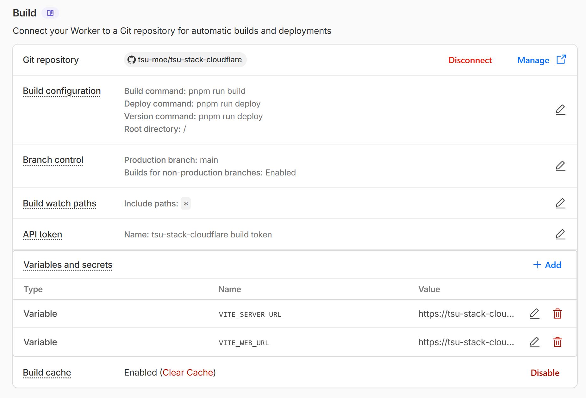
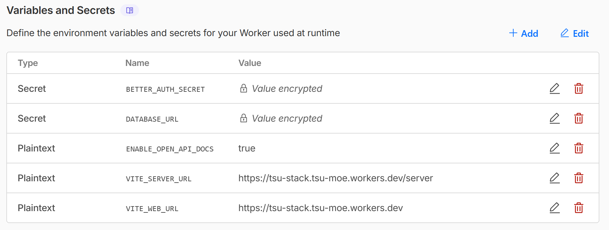

<h1 align="center">
    <br>
    <a href="https://tsu-stack.tsu.moe/">tsu!stack</a>
</h1>

<p align="center">
   
   
   
   
   
   
   
   
</p>

<p align="center">
  Vite Plus (Vite+) TanStack Start monorepo with Paraglide.js (i18n), Hono, oRPC, drizzle-orm, better-auth, Feature-Sliced Design (FSD), and more. Dockerized and opinionated.
</p>

<p align="center">
  
</p>

<p align="center">
  <strong>✨ Live Demo Deployments ✨</strong><br />
  <a href="http://tsu-stack.tsu.moe" target="_blank">Dockerfile (Coolify)</a><br>
  <a href="http://tsu-stack-coolify.tsu.moe" target="_blank">Docker Compose (Coolify)</a><br>
  <a href="http://tsu-stack-merged.tsu.moe" target="_blank">Merged Web + Server with Dockerfile (Coolify)</a> | <a href="https://github.com/tsu-moe/tsu-stack/tree/variant/merged" target="_blank">see branch</a><br>
  <a href="https://tsu-stack.tsu-moe.workers.dev" target="_blank">Merged Web + Server (Cloudflare Workers)</a> | <a href="https://github.com/tsu-moe/tsu-stack/tree/variant/merged-cloudflare" target="_blank">see branch</a>
</p>

## Table of Contents

- [Tech Stack](#tech-stack)
- [Getting Started](#getting-started)
  - [Prerequisites](#prerequisites)
  - [Setup](#setup)
  - [Running with Docker Locally](#running-with-docker-locally)
- [Deployment](#deployment)
  - [Coolify](#coolify)
    - [Option 1: Separate Dockerfiles](#option-1-separate-dockerfiles)
      - [Server Deployment](#server-deployment)
      - [Web Deployment](#web-deployment)
    - [Option 2: Docker Compose](#option-2-docker-compose)
  - [Cloudflare Workers](#cloudflare-workers)
    - [Git-based CI/CD](#git-based-cicd)
  - [Deploying to Other Platforms](#deploying-to-other-platforms)
- [Environment Variables](#environment-variables)
  - [Server](#server)
  - [Web](#web)
- [Merging Server to Web App](#merging-server-to-web-app)
  - [Resource Usage](#resource-usage)
- [Issue Watchlist](#issue-watchlist)
  - [Pitfalls](#pitfalls)
- [Contributing](#contributing)
- [Acknowledgements](#acknowledgements)
- [License](#license)

## Tech Stack

Here is a non-exhaustive list of the main technologies used in this project, along with their purposes and possible alternatives they replace:

| Technology                                        | Purpose                                                                                                                                                                                    | Replaces/Similar Alternatives                                                      |
| ------------------------------------------------- | ------------------------------------------------------------------------------------------------------------------------------------------------------------------------------------------ | ---------------------------------------------------------------------------------- |
| [**pnpm**](https://pnpm.io/)                      | Fast, disk-efficient package manager for Node.js with package catalogs for monorepo dependecy deduplication.                                                                               | npm, yarn                                                                          |
| [**Vite Plus (Vite+)**](https://viteplus.dev/)    | Unified toolchain for development, testing, and building the monorepo.                                                                                                                     | Turborepo, Nx, Vitest, Prettier, ESLint, husky, lint-staged, lefthook, tsdown, tsc |
| [**TanStack Start**](https://tanstack.com/router) | Modern full-stack React framework with support for SPA, SSR, ISR, and integrated with TanStack Query. This branch configures it for Cloudflare Workers through the Cloudflare Vite plugin. | Next.js, Remix, React Router                                                       |
| [**Paraglide.js**](https://paraglide.dev/)        | Compiled internationalization (i18n) library for managing translations.                                                                                                                    | i18next, next-intl                                                                 |
| [**Hono**](https://hono.dev/)                     | Lightweight web server framework built on web standards and is WinterCG-compliant for cross-platform portability.                                                                          | Express.js, Fastify, Elysia.js                                                     |
| [**oRPC**](https://orpc.dev/)                     | RPC framework to define API routes and generate OpenAPI specs and documentation with [Scalar](https://scalar.com/).                                                                        | tRPC                                                                               |
| [**Drizzle ORM**](https://orm.drizzle.team/)      | Type-safe and lightweight ORM for database interactions.                                                                                                                                   | Prisma, TypeORM                                                                    |
| [**Neon Postgres**](https://neon.com/)            | Serverless Postgres database for development and deployment.                                                                                                                               | PostgreSQL, MySQL, MariaDB                                                         |
| [**Better Auth**](https://better-auth.com/)       | Self-hosted authentication framework with support for all major OAuth providers.                                                                                                           | Auth.js                                                                            |
| [**Docker**](https://www.docker.com/)             | Containerization for local development and deployment.                                                                                                                                     | Podman                                                                             |
| [**shadcn/ui**](https://ui.shadcn.com/)           | Accessible and customizable React component library.                                                                                                                                       | Chakra UI, Material UI, Mantine UI                                                 |

## Getting Started

### Prerequisites

- **Node.js** ≥ 25
  - install via [Node.js official website](https://nodejs.org/) or [nvm](https://github.com/nvm-sh/nvm)
- **Vite Plus (vp)**
  - install via `curl -fsSL https://vite.plus | bash` (macOS/Linux) or `irm https://vite.plus/ps1 | iex` (Windows)
- **pnpm** ≥ 10
  - install via `vp install -g pnpm`
- **Docker**
  - install it via their [official website](https://www.docker.com/)

### Setup

1. **Clone the repository and install dependencies:**

   ```bash
   vpx tiged https://github.com/tsu-moe/tsu-stack#main my-tsu-stack-app
   # Available branch specifiers: `main` | `variant/merged` | `variant/merged-cloudflare`

   cd my-tsu-stack-app
   vp env install    # install Node.js version specified in package.json
   vp install        # install all packages in the monorepo
   ```

2. **Copy the environment files:**

   ```bash
   cp packages/env/.env.example packages/env/.env
   ```

3. **Generate a Better-Auth secret** and set it as `BETTER_AUTH_SECRET` in `packages/env/.env`:

   ```bash
   vp run auth:secret
   ```

4. **Create an initial dev Neon database URL if `DATABASE_URL` is missing:**

   ```bash
   vp run db:setup
   ```

   This is a first-time dev setup command. It wraps `vpx neon-new@latest --env ../../packages/env/.env --key DATABASE_URL --ref github:salahmohsen/portfolio --yes` in `packages/db` and writes the Neon `DATABASE_URL` to `packages/env/.env`.

5. **Migrate the database**:

   ```bash
   vp run db:migrate
   ```

6. **Start all development servers:**

   ```bash
   vp run dev
   ```

   The following applications will be running:
   - **Web App**: `http://localhost:3000/web`
   - **Server**: `http://localhost:5000/server`

> [!TIP]
> Run `vp run fix` to lint, format, and type-check your code. This is also automatically run when you do `git commit`.

### Running with Docker Locally

As an alternative to `vp run dev`, you can run the full stack inside Docker using the local compose file:

```bash
cp .env.docker.example .env.docker # And set environment variables as needed
vp run docker:up
vp run docker:up:build # OR: force a rebuild when you make changes to the code
```

## Deployment

This project is designed to be deployed as separate applications for the server and web frontend. Below are the recommended deployment strategies and configurations.

### Coolify

Coolify can be used to deploy the server and web applications. Choose a strategy and follow the steps below to configure each app:

#### Option 1: Separate Dockerfiles

> [!WARNING]
> This approach retains rolling updates in Coolify and has minimal downtime, but it is harder to scale compared to Docker Compose.

##### Server Deployment

1. **Base Directory**: Set to `/apps/server`.
2. **Domain**: Assign a domain, e.g., `https://example.com/server`.
3. **Port**: Expose port `5000`.

##### Web Deployment

1. **Base Directory**: Set to `/apps/web`.
2. **Domain**: Assign a domain, e.g., `https://example.com/web`.
3. **Port**: Expose port `3000`.

> [!CAUTION]
> Ensure that the `Strip Prefixes` option is unchecked in the `Advanced` settings to avoid issues with custom base paths.

Finally, set any required [environment variables](#environment-variables) in the "Environment Variables" tab for each application and press the "Deploy" button to start the deployment process.

#### Option 2: Docker Compose

1. When creating a new application in Coolify, select "Private Repository (with GitHub App)" and select your repository with your tsu-stack app.
2. Next, change the "Build Pack" to "Docker Compose" and set the "Docker Compose Location" to `/docker-compose.coolify.yaml`.
3. Refer to [Server Deployment](#server-deployment) and [Web Deployment](#web-deployment) sections above for domain configurations.

- you need to explicitly bind the port in the domain since Docker Compose doesn't have `Expose Port`, for example: `https://example.com:3000/web` for the web app and `https://example.com:5000/server` for the server.

4. Set any required [environment variables](#environment-variables) in the "Environment Variables" tab.
5. Press the "Deploy" button to start the deployment process.

> [!CAUTION]
> Ensure that the `Strip Prefixes` option is unchecked in the `Advanced` settings to avoid issues with custom base paths.

### Cloudflare Workers

Both deployable apps in this monorepo can target Cloudflare Workers:

- `apps/web` via the Cloudflare Vite plugin
- `apps/server` via Hono's Worker-compatible `app.fetch` entrypoint

This monorepo is not a single root-level Worker project. Configure Cloudflare to treat each app as its own Worker project:

- **Web Worker**
  - Root directory: `apps/web`
  - Wrangler config: `apps/web/wrangler.jsonc`
- **Server Worker**
  - Root directory: `apps/server`
  - Wrangler config: `apps/server/wrangler.jsonc`
- **Shared watch paths**:
  - `apps/web/**`
  - `apps/server/**`
  - `packages/api/**`
  - `packages/auth/**`
  - `packages/core/**`
  - `packages/db/**`
  - `packages/env/**`
  - `packages/i18n/**`
  - `packages/logger/**`
  - `packages/seo/**`
  - `packages/ui/**`
  - `package.json`
  - `pnpm-lock.yaml`
  - `pnpm-workspace.yaml`

For local development and manual deploys:

```bash
cd apps/web
pnpm wrangler login
pnpm run dev
pnpm run deploy

cd ../server
pnpm run dev
pnpm run deploy
```

The web Worker keeps using the app dev command through the Cloudflare Vite plugin. The server Worker now does the same and derives its local dev port from `VITE_SERVER_URL`.

> [!NOTE]
> In local Worker dev, Cloudflare does not expose arbitrary shell env vars to `process.env` by default. This repo loads `packages/env/.env` through `dotenvx` and sets `CLOUDFLARE_INCLUDE_PROCESS_ENV=true` in the app `dev` scripts so the Worker runtime can read `DATABASE_URL`, `BETTER_AUTH_SECRET`, and the shared `VITE_*` values.

> [!NOTE]
> `apps/server` no longer needs a separate Node bootstrap for normal development. The Worker entry is driven through the Cloudflare Vite plugin and Wrangler config.

> [!NOTE]
> `apps/server` runs `pnpm db:migrate` before `wrangler deploy` so schema changes are applied before the new Worker version starts serving traffic.

> [!NOTE]
> `apps/server` disables Vite's built-in `server.cors` in dev so Hono's own CORS middleware handles preflight requests. This follows the Hono guidance for Vite-based setups: https://hono.dev/middleware/builtin/cors

#### Git-based CI/CD

You can take advantage of Cloudflare's Git-based CI/CD by connecting your GitHub repository to your Cloudflare account and configuring the deployment settings to automatically deploy on pushes to your `main` branch.

For Workers Builds in this monorepo:

1. Create or connect one Worker for `apps/web` and another for `apps/server`.
2. Set each Worker root directory to its app directory.
3. Keep the deploy command at the Wrangler default or set it explicitly to `npx wrangler deploy`.
4. Add watch paths that match the shared packages used by each app.

You will need to set up the Worker _variables and secrets_ manually in the Cloudflare dashboard in order for builds to succeed:

- Worker variables and secrets:
  - `VITE_SERVER_URL`
  - `VITE_WEB_URL`
  - `DATABASE_URL`
  - `BETTER_AUTH_SECRET`
  - `SOURCE_COMMIT`
  - `VITE_IMGPROXY_URL` if used

| **Build Settings**                                                       | **Secrets & Variables**                                                         |
| ------------------------------------------------------------------------ | ------------------------------------------------------------------------------- |
|  |  |

> [!NOTE]
> `process.env` is populated in Workers when `nodejs_compat` is enabled and the compatibility date is `2025-04-01` or later. This repo relies on that behavior for shared env loading in both Worker runtimes.

### Deploying to Other Platforms

This branch configures the **web app** for Cloudflare Workers through the Cloudflare Vite plugin and the **server app** through a standalone Hono Worker entry. If you want to target another platform again, switch the relevant app's runtime adapter or bootstrap entrypoint for that deployment target.

## Environment Variables

### Server

For the Hono server, use the following environment variables in either Node or Cloudflare Worker runtime:

| Variable Name          | Required | Default Value | Description                                                                                      |
| ---------------------- | -------- | ------------- | ------------------------------------------------------------------------------------------------ |
| `VITE_SERVER_URL`      | ✅       | -             | Base URL for the server. May also include a subpath if needed, ex: `https://example.com/server`. |
| `VITE_WEB_URL`         | ✅       | -             | Base URL for the web app. May also include a subpath if needed, ex: `https://example.com/web`.   |
| `BETTER_AUTH_SECRET`   | ✅       | -             | Secret key for Better-Auth. Generate with `vp run auth:secret`.                                  |
| `DATABASE_URL`         | ✅       | -             | Neon Postgres connection string.                                                                 |
| `ENABLE_OPEN_API_DOCS` | ❌       | `false`       | Enable OpenAPI `/docs` endpoint.                                                                 |

### Web

For the web app, use the following environment variables:

| Variable Name        | Required | Default Value | Description                                                                                                                         |
| -------------------- | -------- | ------------- | ----------------------------------------------------------------------------------------------------------------------------------- |
| `VITE_SERVER_URL`    | ✅       | -             | Base URL for the server. May also include a subpath if needed, ex: `https://example.com/server`.                                    |
| `VITE_WEB_URL`       | ✅       | -             | Base URL for the web app. May also include a subpath if needed, ex: `https://example.com/web`.                                      |
| `BETTER_AUTH_SECRET` | ✅       | -             | Secret key for Better-Auth. Generate with `vp run auth:secret`.                                                                     |
| `DATABASE_URL`       | ✅       | -             | Neon Postgres connection string.                                                                                                    |
| `VITE_IMGPROXY_URL`  | ❌       | -             | URL for image optimization. You'll need to deploy your own [imgproxy](https://hub.docker.com/r/darthsim/imgproxy/) container first. |

## Merging Server to Web App

> [!TIP]
> An example can be found in the [`variant/merged`](https://github.com/tsu-moe/tsu-stack/compare/variant/merged) branch. You can check [this commit](https://github.com/tsu-moe/tsu-stack/commit/cf576db302cc1380bf0f5f27017cf0951ea1c6c5) to see the changes needed.

Since Hono is built on web standards, you can mount the Hono App into the TanStack Start web server.

```json5
// apps/web/package.json
"dependencies": {
  // ...
  "@tsu-stack/i18n": "workspace:*",
  "@tsu-stack/server": "workspace:*", // add this to import the server app into the web app
  "@tsu-stack/ui": "workspace:*",
  // ...
}
```

Then we can import our app from the server package.

```ts
// apps/web/src/routes/server/$.ts
import { createFileRoute } from "@tanstack/react-router";

import { app } from "@tsu-stack/server";

export const Route = createFileRoute("/server/$")({
  server: {
    handlers: {
      GET: ({ request }) => {
        return app.fetch(request);
      },

      POST: ({ request }) => {
        return app.fetch(request);
      }
    }
  }
});
```

Then merge your web environment variables with the server ones and make sure `VITE_SERVER_URL` points to the web domain's subpath.

```diff
-VITE_SERVER_URL=http://localhost:5000/server
+VITE_SERVER_URL=http://localhost:3000/web/server
VITE_WEB_URL=http://localhost:3000/web
```

With the current server shape, `@tsu-stack/server` already exports the shared Hono app from `apps/server/src/index.ts`, so you only need to keep that export runtime-neutral. Do not reintroduce a Node-only `serve()` bootstrap if the app is being mounted into TanStack Start.

> [!WARNING]
> You may want to refactor the logging middlewares since the TanStack Start server also logs incoming/outgoing requests, similar to the Hono app's middleware.

> [!WARNING]
> You may also need to adjust your Docker Compose file and the `apps/web/Dockerfile` to include build args needed in the server app such as `DATABASE_URL` and handle other environment variables.

### Resource Usage

When mounting the Hono app into the TanStack Start web server, you will save the resources of running a separate Node.js server.

But keep in mind that all API requests will now consume resources from the web server container, leading to the web server being less responsive under heavy API load.

However, the benefit is singular deployments and lower memory usage for websites that don't receive much traffic (around 70MB with a single app vs 130MB when separated on idle).

> [!NOTE]
> I personally keep them separated so that when it's time to scale, I can scale the web server independently or deploy it to another platform like Cloudflare Workers for serverless edge performance.

## Issue Watchlist

- [Router/Start issues](https://github.com/TanStack/router/issues) - TanStack Start is in RC.
- [Devtools releases](https://github.com/TanStack/devtools/releases) - TanStack Devtools is in alpha and may still have breaking changes.
- [Better Auth experimental Drizzle adapter](https://github.com/better-auth/better-auth/pull/9489) - We're using a separate branch of Better Auth's Drizzle adapter that supports Drizzle relations v2.
- [Cloudflare Vite plugin docs](https://developers.cloudflare.com/workers/vite-plugin/) - The web and server Cloudflare dev paths now depend on the plugin behavior and Wrangler integration staying stable.
- [Vite+ issues](https://github.com/voidzero-dev/vite-plus/issues) - Vite+ is in alpha.

### Pitfalls

- Better Auth uses its default cookie settings (`SameSite=Lax`) here to better support OAuth and other redirect-based flows. Cross-domain deployments still require deliberate cookie, domain, and CORS configuration. See [Better Auth cookie docs](https://better-auth.com/docs/concepts/cookies#safari-itp-and-cross-domain-setups) for context.
- This implementation does not include security headers by default. You should add the following headers in production for improved security:
  - `Content-Security-Policy`
  - `Strict-Transport-Security`
  - `X-Frame-Options`
  - `X-Content-Type-Options: nosniff`
  - `Referrer-Policy`
  - `Permissions-Policy`
- Builds are slower and more bloated in general because Vite Plus does not have a [`turbo prune`](https://turborepo.dev/docs/reference/prune) alternative
  - See this related issue: https://github.com/voidzero-dev/vite-plus/issues/839
- On a similar note, there isn't an elegant way to install `vp` in Dockerfile images, so you need to manually bump the desired `vp` version in the `/apps/*/Dockerfile`'s `VITE_PLUS_VERSION` variable.
- There is a hydration error when navigating to an i18n subpath like `/de`, but it subsides in subsequent navigations.
  - Need to investigate further, but otherwise, I haven't encountered any app-breaking bugs with it.
- `robots.txt` [needs to be at the root of the domain](https://developers.google.com/search/docs/crawling-indexing/robots/intro) to be detected by search engines (ie. `example.com/robots.txt`), but since the web app is served on a subpath (ie. `example.com/web`), you need to set up a redirect from `example.com/robots.txt` to `example.com/web/robots.txt` in order for it to be detected.
  - Other than that, you may need to set up a root sitemap index that links to as many sitemaps for every app you deploy in multiple subpaths.
    - At the moment, the `__root.tsx` points to the subpath-specific sitemap, so you may want to consider pointing it to the root if you decide to opt into that architecture.
  - Alternatively, you can simply deploy the web app in the root so that the files are hosted in `example.com/robots.txt` and `example.com/sitemap.xml` instead of `example.com/web/robots.txt` and `example.com/web/sitemap.xml`.

## Contributing

Pull requests are welcome. For major changes, please open an issue first to discuss what you would like to change. If there are any bugs, please open an issue.

To get started, fork the repo, make your changes, add, commit, and push your changes to your fork. Then, open a pull request. If you're new to GitHub, [this tutorial](https://www.freecodecamp.org/news/how-to-make-your-first-pull-request-on-github-3) might help.

You can support the project by giving it a star, sharing it with your friends, contributing to the project, and reporting any bugs you find.

## Acknowledgements

This repository builds on [mugnavo/tanstarter-plus](https://github.com/mugnavo/tanstarter-plus).

- It will continue to be a reference for new dependency features.

## License

This project is licensed under the MIT License - see the [LICENSE](../LICENSE) file for details.
