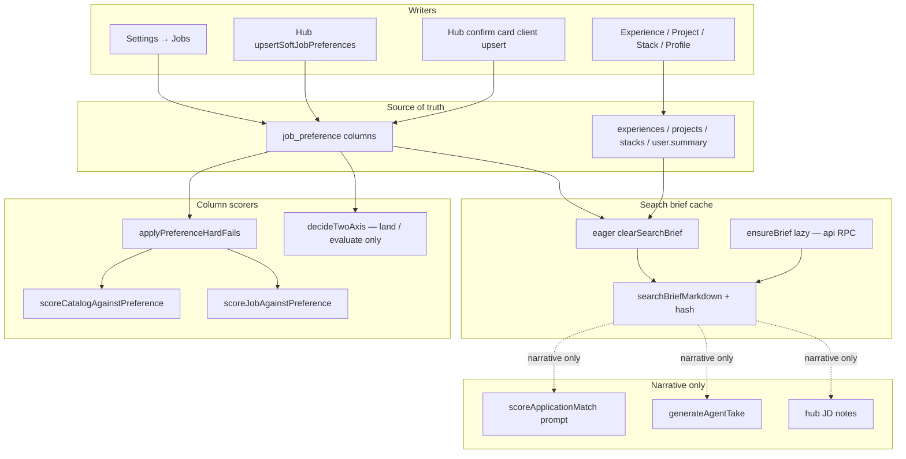
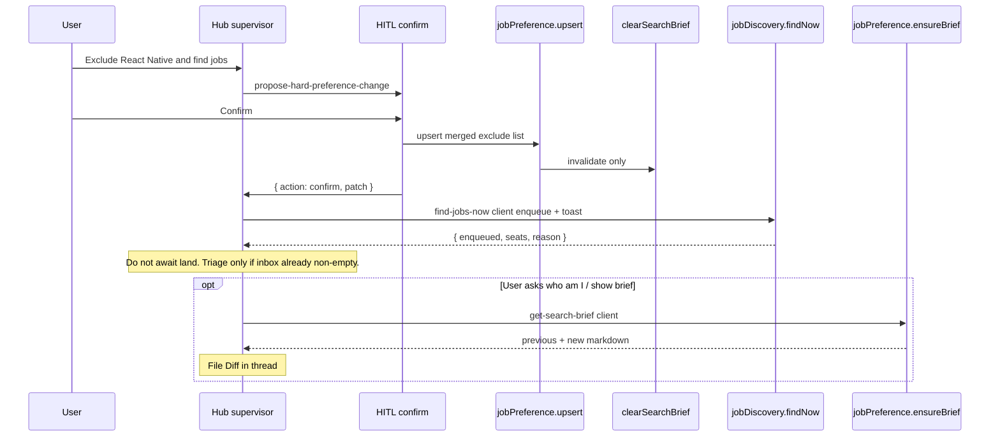
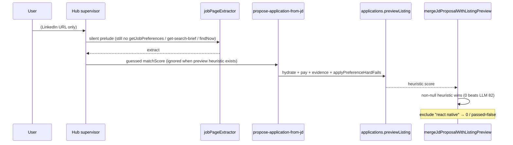

# Search brief + hub operator — design

**Date:** 2026-08-16  
**Author:** Salah  
**Status:** Accepted (grill complete; ready for implementation plan)  
**Surfaces:** Settings → Jobs, evidence inspect (view-only) + hub interview, hub chat (`/dashboard` + floater), New jobs / Find jobs now, harvest + inbox-AI + hub JD card  
**Verification skill:** [ai-feature-harness](../../../.agents/skills/ai-feature-harness/SKILL.md) (required after implement; living lessons in that skill’s `LESSONS.md`)  
**Glossary:** [CONTEXT.md](../../../CONTEXT.md) — Job search section is source of terms (`job preference`, `search brief`, `level floor`, `remote regions`, `hub operator`, `entity inspect panel`). Human evidence writes: conversational evidence spec.  
**Related:**

- [Job preference two-axis matching](./2026-08-15-job-preference-two-axis-extraction-design.md) — remote **land** branch superseded here (`remoteRegions`; see that spec’s supersedes box)
- [Job discovery adapters](./2026-08-14-job-discovery-adapters-design.md) — cheap exclude / title phrase match
- [Hub agent superpowers tools](./2026-08-13-hub-agent-superpowers-tools-design.md) — URL-import scoring; silent prelude stays
- [Hub HITL card family](./2026-08-15-hub-hitl-card-family-design.md) — confirm card for hard stops
- [Hub onboarding playbook](./2026-08-15-hub-onboarding-playbook-design.md) — search-loop must not call playbook `upsert-job-preferences`
- [Career Inbox + AI platform](./2026-07-29-career-inbox-ai-platform-design.md)
- ADR [0025](../../adr/0025-entity-form-sheet.md) — entity form panel

**Does not reopen.** Grill lock from the product owner. Implementation may refine file names, not the frozen table.

---

## 1. Goal

Make **job preference** the only source of truth for what the seeker wants, expose the missing hard-stop fields (level floor, monthly salary, remote regions), and make **every** scoring path obey those columns — including hub URL-paste.

Give the hub supervisor a **search-loop operator** on the same Career OS objects (prefs, search brief, evidence forms, Find jobs now, New jobs, apply). Chat is another door, not a second product.

Give AI layers **one generated markdown artifact** — the **search brief** — so “who am I / what am I looking for?” has a single document. Paragraphs never override structured hard stops.

**Incident that forced this:** hub URL-paste scored a **Senior React Native Engineer** at **82%** despite exclude keyword `react native`. Root causes (all real in tree today):

| Fault                                                                              | Where                                                                                                                                            |
| ---------------------------------------------------------------------------------- | ------------------------------------------------------------------------------------------------------------------------------------------------ |
| Hub card prefers any LLM `matchScore > 0` over preview heuristic                   | `mergeJdProposalWithListingPreview` in `apps/web/src/features/agent-hub/lib/complete-jd-proposal.ts` (`inputScore > 0` wins)                     |
| URL-import prelude **forbids** `getJobPreferences`                                 | `HUB_JOB_URL_IMPORT_FEEDBACK` in `apps/agent/src/mastra/lib/hub-superpowers-policy.ts`                                                           |
| Agent take prompt omits exclude + evidence                                         | `prefsSummaryFromRow` in `packages/api/src/lib/application/generate-agent-take.ts`                                                               |
| AI scorer can ignore a heuristic exclude-zero                                      | `scoreApplicationMatch` in `packages/api/src/lib/application/score-application-match.ts` uses `hit.passed` without short-circuit                 |
| Exclude / role match is raw substring                                              | `includesAny` in `packages/core/src/mail/job-harvest.ts` and `packages/core/src/job-discovery/cheap-score.ts` — `react` is inside `react native` |
| Frontend title pack seeds `react`                                                  | `TITLE_PACKS.frontend` / `fullstack` in `packages/core/src/job-discovery/constants.ts`                                                           |
| Salary columns exist but are not on the Jobs form                                  | `salaryMin` / `salaryCurrency` on `job_preference`; omitted from `JobPreferenceFields` / `JobPreferenceFormState`                                |
| `previewListing` hardcodes `salaryRange: null`                                     | `packages/api/src/routers/applications.router.ts` — hub salary floor cannot fire until extract pay is persisted                                  |
| `hiringRegionsOverlap` treats user `worldwide` as a pass for **hybrid/onsite** too | `packages/core/src/job-discovery/hiring-region.ts` (`user.hasWorldwide return true`)                                                             |

---

## 2. Non-goals

- A second Career identity file, editable markdown source, or scoring from brief prose.
- Negotiation coach, handbooks, mock interviews, visibility modes, Jill-clone career OS.
- Target sectors, target companies, extra title lists, expected pay, fit calibration bands (deferred).
- FX conversion (currency mismatch is **not** a kill).
- Extracting `ExperienceForm` / `ProjectForm` / `StackForm` into `packages/ui`.
- Duplicating those forms as hub-only chat forms.
- Opening a side panel for the search brief (jal-co Diff Viewer is **out**).
- A second Find jobs / ingest / land pipeline.
- Inferring hard stops from spoken prose (“I’m more senior now” must not raise `levelFloor`).
- Platform-funded LLM keys. Brief prose uses tenant BYO (`scorer`), same as today’s take/score.
- Changing N range, 50-cap, 2×N, TTL, adapter set, or evaluate-then-insert (two-axis spec still owns those).
- Playbook full-form `upsert-job-preferences` elicitation as the **search-loop** write path (playbook 3b may still mount `JobPreferenceFields` for onboarding; this spec does not).
- Applying two-axis unknown-mode **drop** to cheap rank, mail harvest, or hub preview (that gate stays land / evaluate / `countTwoAxisPassedUnseen`).

---

## 3. Frozen decisions (grill log)

| #   | Topic            | Decision                                                                                                                                                                                                                                                                                                                                                                                                                                                         |
| --- | ---------------- | ---------------------------------------------------------------------------------------------------------------------------------------------------------------------------------------------------------------------------------------------------------------------------------------------------------------------------------------------------------------------------------------------------------------------------------------------------------------- |
| 1   | Artifact         | **One artifact: Search brief.** Opening + skills paragraphs = who I am (experiences / stacks / projects / profile). Lists restate job preference. “What is my identity?” reads this brief. Paragraphs are **never** hard stops. Only Exclusions, compensation Minimum, and Level floor are law. Scorers use **structured columns**, not prose.                                                                                                                   |
| 2   | Source of truth  | **Job preference** is SoT. Settings + spoken writes. Search brief is a generated projection / cache.                                                                                                                                                                                                                                                                                                                                                             |
| 3   | v1 fields        | **Level floor** `junior \| mid \| senior \| staff`. **Monthly** salary floor + ISO currency (`salaryMin` + `salaryCurrency` already in DB — must surface). One exclude list (existing). Split location: **`locations`** = onsite/hybrid places; **`remoteRegions`** empty = worldwide remote, else only those hiring regions. **Do not** put `worldwide` on the hybrid locations list. Defer: sectors, companies, extra titles, expected pay, calibration bands. |
| 4   | Cache            | **Lazy rebuild + eager invalidate.** Store markdown + content hash next to job preference. Any successful write to prefs or evidence (Settings, hub speech, evidence Confirm) **clears cache immediately**. Next AI layer rebuilds if hash stale / missing. **Never** score against previous markdown after invalidate.                                                                                                                                          |
| 5   | Hub              | **Operator, not Jill clone.** Chat is another door to the same objects. Dashboard stays the board. v1 conversation = search loop: brief, spoken prefs, evidence interview + ApprovalCard, Find jobs now, list/triage, apply.                                                                                                                                                                                                                                     |
| 6   | Write policy     | **Immediate:** title pack, role keywords, work modes, locations, remote regions. **Confirm card (small HITL):** salary floor, exclude keywords, level floor. **Never** infer a hard stop from prose.                                                                                                                                                                                                                                                             |
| 7   | Evidence forms   | **Superseded** by [conversational evidence + approval File Diff](./2026-08-16-conversational-evidence-approval-design.md): no human edit form; inspect stays; interview + ApprovalCard File Diff; Confirm writes.                                                                                                                                                                                                                                                |
| 8   | Search from chat | **Find jobs now** (same ingest / land / inbox / daily cap). No second pipeline. Chat reports that search is queued; triage **current** inbox if already non-empty — do not block the turn on land (see KD 13).                                                                                                                                                                                                                                                   |
| 9   | Brief change UI  | **beUI File Diff in the hub thread only** (previous snapshot vs new markdown). **No side panel.** jal-co Diff Viewer is out. Snapshot is for the thread disclosure only, not for scoring. Inspect host wins the panel for view-only evidence. File Diff appears on the next `get-search-brief` / `ensureBrief` (lazy), not on the write itself (see KD 14).                                                                                                      |
| 10  | Remote two-axis  | `locations` gate **hybrid/onsite only**. `remoteRegions` empty → remote worldwide. `remoteRegions` set → remote must overlap those regions.                                                                                                                                                                                                                                                                                                                      |
| 11  | Phrase match     | Fix `react` matching `react native` (word/phrase boundary). Exclude remains hard fail in `scoreJobAgainstPreference` **and** cheap-score **and** inbox AI **and** hub preview/JD card. Hub JD card must **not** prefer LLM `matchScore` over exclude-zero.                                                                                                                                                                                                       |

---

## 4. Key Decisions

Implementation-facing restatement of the grill. These are the contracts PRs must implement.

1. **SoT vs cache.** Persist structured prefs on `job_preference`. Persist `searchBriefMarkdown` + `searchBriefHash` (+ previous-markdown snapshot for File Diff only) on the same row. Hash is of the **source payload** (prefs columns + evidence fingerprint + profile name/summary), not of the markdown. Invalidate = null markdown + null hash (copy outgoing markdown into `searchBriefPreviousMarkdown` first). Rebuild is lazy on the next AI consumer.

2. **Hard stops are columns.** `excludeKeywords`, `levelFloor`, `salaryMin`+`salaryCurrency` are column hard-fails on **every** score path. Two-axis (`workModes` + `locations` + `remoteRegions`) is the **land / evaluate** gate (existing two-axis spec), not a harvest/cheap/hub-preview drop. Brief prose and LLM judgment cannot pass a column hard-fail.

3. **Two functions, two layers (do not collapse).**
   - `applyPreferenceHardFails` = exclude phrase + level floor + salary floor. First stage of cheap, harvest heuristic, inbox AI, preview listing, and hub JD merge. AI `passed` is AND-ed with “no hard fail.”
   - `decideTwoAxis` stays land / evaluate / `countTwoAxisPassedUnseen` only (now with `remoteRegions`). Cheap continues to rank without mode/location kills. Harvest / hub preview do **not** drop unknown mode.

4. **Phrase identity, not substring.** `matchesKeywordPhrase` tokenizes and requires an exact contiguous token span. Known **product** compounds (v1: `react native`) occupy their span so a shorter keyword does not match inside them. Do **not** compound `.js` suffixes (`react.js` still matches `react`). `react` does **not** match `Senior React Native Engineer`. `react native` does.

5. **Remote axis split.** `TwoAxisPrefs` gains `remoteRegions`. `hiringRegionsOverlap` must **not** treat user `worldwide` on `locations` as a hybrid/onsite pass. Worldwide remote is `remoteRegions.length === 0`. Migration **copies** existing non-worldwide location slugs onto `remoteRegions` so Egypt/KSA tenants keep today’s remote filter (see §6.5 / §8).

6. **Hub is a door.** New tools wrap existing domain / existing oRPC (`jobPreference.upsert`, `jobDiscovery.findNow`, original entity forms). No parallel search, no hub-only forms. Hard-stop writes happen **on the confirm card** (client `upsert`). There is **no** model-callable `apply-hard-preference-change`.

7. **URL import stays silent; scoring moves server-side.** Keep `getJobPreferences` locked out of the extract prelude. `applications.previewListing` / `previewListingTake` / JD merge apply hard-fails + full prefs + evidence. Brief is narrative-only on take / inbox AI / hub notes — never on cheap.

8. **BYO + tenant.** Brief generation uses `resolveRuntimeAiCredentials(userId, "scorer")`. No key → structured lists only, no invented prose. `userId` only from session / `requestContext`. Brief generate does **not** increment `user_job_ai_budget` / 2×N (same class as agent take).

9. **Playbook vs search loop.** Onboarding playbook may still elicit the full Jobs form (`upsert-job-preferences`). The search-loop operator uses immediate soft writes + a small hard-stop confirm card — not `JobPreferenceFields` in the thread. Search-loop must not call the playbook tool.

10. **`ensureSearchBrief` lives in `@tsu-stack/api`.** Hub `get-search-brief` is a **client** tool that calls `jobPreference.ensureBrief` (same pattern as `find-jobs-now` → existing RPC). Settings `get` stays cheap. Invalidate is db-only (`clearSearchBrief` on the job-preference repository). Agent soft upsert uses `createDb` / `runWithDb` + `clearSearchBrief` and **never** generates prose. Agent must not import `@tsu-stack/api`.

11. **List writes are deltas.** Soft and hard list fields use `{ op: "add" \| "remove" \| "set", values }` (or the tool loads current prefs and sends the full merged list). `mergeJobPreference` still replaces when a full array is present — tools must not send a one-item array as a silent replace. Confirm card shows the delta (“Add exclude: PHP — keep React Native, …”).

12. **Find now completes on enqueue.** Client tool calls `orpcClient.jobDiscovery.findNow`, starts the existing toast tracker **without awaiting the poll**, returns `{ enqueued, seats, reason }` immediately. Supervisor reports that search is queued. **Do not** auto-triage unless `listNewJobs` is already non-empty. Same toast / caps as the header button.

13. **Hub writes invalidate only.** File Diff appears on the next `get-search-brief` / `ensureBrief` (lazy). Settings save and chat share one rebuild policy. Sequence: write → invalidate → (optional) client `get-search-brief` if the user asked who they are or the supervisor wants to show the disclosure — not an eager LLM on every upsert.

14. **No `job_preference` row.** `ensureBrief` returns lists-only markdown from `defaultJobPreference()` **without insert**. `clearSearchBrief` / invalidate is a no-op. Creating a row from “who am I?” would surprise Settings.

---

## 5. Current state (verified)

### Preference storage

`packages/db/src/schema/job-preference.schema.ts` — one row per user (`job_preference_user_id_unique_idx`). Already has `salaryMin`, `salaryCurrency`, `excludeKeywords`, `locations`, `workModes`. **No** `levelFloor`, **no** `remoteRegions`, **no** brief columns.

`packages/core/src/job-preference/types.ts` — `JobPreferenceFieldsSchema` includes salary; `UpsertJobPreferenceInputSchema` already accepts it.

`apps/web/src/features/job-preference/ui/job-preference-fields.tsx` + `lib/job-preference-form.ts` — **no salary fields**, no level, no remote regions. Locations copy still says remote uses hiring-region overlap against the **same** locations list.

### Scoring

```
cheap (catalog structured)     scoreCatalogAgainstPreference   — substring exclude; mode/location are later gates
harvest heuristic              scoreJobAgainstPreference       — substring exclude; no salary/level kill; unknown mode ranking-neutral
$0 two-axis                    decideTwoAxis                   — remote overlaps user.locations; user worldwide passes hybrid
inbox AI                       scoreApplicationMatch          — AI can ignore heuristic exclude
hub preview                    applications.previewListing    — heuristic without evidence; salaryRange hardcoded null
hub JD merge                   mergeJdProposalWithListingPreview — LLM score > 0 wins
agent take                     prefsSummaryFromRow            — omits exclude, evidence, brief
```

`haystackHasPhrase` already exists in `job-harvest.ts` for evidence stacks, but exclude / role keywords still use `String.includes`. Word-boundary regex still matches `react` inside `react native`.

### Hub

`createHubSupervisor` has `getJobPreferences` (read) and no upsert / findNow / open-entity-form. URL paste forces extract → `propose-application-from-jd` with a model-guessed `matchScore`.

Entity forms already take `{ open, onOpenChange, initialData }` and call `onOpenChange(false)` on successful create/update. Dashboard layout (`apps/web/src/routes/(root-layout)/__protected/dashboard/route.tsx`) already hosts `HubChatProvider`, `HubApplicationsSync`, and `DetectStacksResultsHost` — the pattern for a stay-put form host.

Find jobs now is `jobDiscovery.findNow` → ingest/land queues (`packages/api/src/routers/job-discovery.router.ts` + `apps/web/src/features/job-discovery/api/find-jobs-now-job.tsx`). `findNow` **enqueues only**. `startFindJobsNow` polls up to ~340s and returns `Promise<void>`. Daily 2×N + 50 inbox cap unchanged.

Client HITL sets today: `HUB_CLIENT_HITL_TOOL_NAMES` (`apps/agent/src/mastra/lib/hub-superpowers-policy.ts`), `HUB_CLIENT_RESUME_TOOL_NAMES` / `hideHubAssistantTextAfterIndex` (`apps/web/src/features/agent-hub/lib/should-auto-resume-hub-chat.ts`), `isHubChoiceToolName` (`hub-agent-activity.ts`), `filterHubJobUrlImportActiveTools` (extract + propose only).

---

## 6. Proposed design

### 6.1 Architecture

```text
                    Settings Jobs form          Hub speech
                    Entity forms / profile      (soft write / hard HITL card upsert)
                              │                           │
                              ▼                           ▼
                     jobPreference.upsert          same oRPC / repo upsert
                              │                           │
                              ▼                           ▼
                    clearSearchBrief(userId, source)     — db only
                              │
                              │  markdown=null, hash=null
                              │  previous = outgoing markdown
                              ▼
                 ┌────────────────────────────────────────┐
                 │ job_preference (SoT + brief cache)     │
                 │  structured columns                    │
                 │  searchBriefMarkdown / Hash / Previous │
                 └────────────────────────────────────────┘
                              │
          next consumer (lazy) if hash miss / stale
                              │
                              ▼
                 jobPreference.ensureBrief  — @tsu-stack/api + BYO scorer
                    │                    │
                    │ has key            │ no key / no row
                    ▼                    ▼
                 prose + lists        lists only (no insert if no row)
                              │
         structured columns ──► cheap / harvest / preview / land two-axis
         brief (narrative)  -.-> take / inbox AI prompt / hub notes
```



Cheap and harvest read **structured columns** only. Brief never enters `scoreCatalogAgainstPreference`.

### 6.2 Search brief markdown (v1)

Fill only what we store or can infer. **Omit** unused headings so models do not invent Target sectors / companies / Fit calibration.

```markdown
{opening paragraph — AI from evidence + title pack + profile name/summary}

## Target jobs

- Example titles: {title pack label and/or customTitle; else roleKeywords}
- Level floor: {junior|mid|senior|staff or "none"}
- Exclusions: {excludeKeywords joined, or "none"}

## Location

- Modes: {workModes or "any"}
- On-site / hybrid places: {locations or "none — onsite/hybrid will not land"}
- Remote regions: {remoteRegions or "worldwide"}

## Compensation

- Minimum monthly: {salaryMin salaryCurrency or "none"}

## Skills

{paragraph — wants to work with featured/stack names + project titles}

- Exclusions: {excludeKeywords or "none"}
```

Opening + Skills paragraphs are **who I am**. Lists **restate columns**. If BYO key is missing, emit the list sections from columns only (no opening/skills prose).

Canonical source payload for `searchBriefHash` (SHA-256 of stable JSON, keys sorted):

```ts
type SearchBriefSource = {
  prefs: {
    workModes: WorkMode[];
    locations: string[];
    remoteRegions: string[];
    roleKeywords: string[];
    excludeKeywords: string[];
    salaryMin: number | null;
    salaryCurrency: string | null;
    levelFloor: LevelFloor | null;
    titleId: JobTitleId | null;
    customTitle: string | null;
  };
  evidence: SeekerMatchEvidence;
  profile: { name: string; summary: string };
};
```

`jobsPerRun`, `minMatchScore`, `importFromEmail` are **not** in the brief source (they do not change the document).

### 6.3 Phrase matching

New helper in `packages/core` (shared by cheap + harvest + hard-fail):

```ts
/**
 * Product compounds: a shorter token is a *different* product if it only
 * appears as the prefix of this span. v1 incident fixture only.
 * Do NOT list `.js` suffixes (`react js`, `next js`, `node js`) — those
 * must still match the short keyword (`react` ↔ `React.js Developer`).
 */
export const KEYWORD_COMPOUNDS = ["react native"] as const;

export function matchesKeywordPhrase(haystack: string, keyword: string): boolean;
export function findMatchingKeywords(haystack: string, keywords: readonly string[]): string[];
```

Algorithm (locked examples are the contract):

1. Normalize: lowercase; map `[._/+-]` → space; collapse whitespace. Keep `#` / `+` glued (`c++`, `c#`).
2. Tokenize on spaces. **Do not** merge `.js` pairs into one token.
3. Keyword tokens must appear as an **exact contiguous span**.
4. **Compound occupancy (keyword-aware):** if the haystack contains a `KEYWORD_COMPOUNDS` span, a **shorter** keyword that is only a prefix of that span does **not** match that occurrence. Multi-token keywords that **are** the compound match the span. Do not merge a compound unless the keyword itself is that compound (or is checking occupancy against it).

Locked examples:

| Haystack                     | Keyword        | Match                                                        |
| ---------------------------- | -------------- | ------------------------------------------------------------ |
| Senior React Native Engineer | `react native` | **yes**                                                      |
| Senior React Native Engineer | `react`        | **no** (occupies `react native`)                             |
| Senior React Engineer        | `react`        | **yes**                                                      |
| React.js Developer           | `react`        | **yes** (`react.js` → `react` + `js`; not a listed compound) |
| PHP Engineer                 | `php`          | **yes**                                                      |

Replace `includesAny` in exclude + role-keyword title hits. **Do not** use this for free-text location overlap (that stays `normalizeHiringRegion`).

`haystackHasPhrase` in `job-harvest.ts` is **not** sufficient (it still matches `react` inside `react native`). New helper is the exclude/role path.

### 6.4 Scoring contract

#### Column hard fails (all score paths)

`applyPreferenceHardFails(job, prefs) → { failed, reasons }`

**Not** a two-axis wrapper. Three rules only:

| Rule           | Kill when                                                                             | Not a kill when                                                                    |
| -------------- | ------------------------------------------------------------------------------------- | ---------------------------------------------------------------------------------- |
| Exclude phrase | `findMatchingKeywords(title+company+location+description, excludeKeywords)` non-empty | No phrase hit                                                                      |
| Level floor    | `inferTitleSeniority(title)` is known **and** `< levelFloor`                          | Floor unset / null; seniority unknown                                              |
| Salary floor   | Stated pay converts to monthly **same currency** and is **< salaryMin**               | Pay unknown; currency mismatch; unparsable range; no period and amount &lt; 15_000 |

`decideTwoAxis` is **not** called from `applyPreferenceHardFails`. Land / evaluate / `countTwoAxisPassedUnseen` keep the existing unknown-mode **drop**. Cheap does not gate mode/location. Harvest heuristic and hub preview treat unknown mode as ranking-neutral (today’s harvest behavior).

`inferTitleSeniority(title)`:

| Tokens in title                 | Level                  |
| ------------------------------- | ---------------------- |
| intern, junior, jr, associate   | `junior`               |
| mid, mid-level, midlevel        | `mid`                  |
| senior, sr                      | `senior`               |
| staff, principal, distinguished | `staff`                |
| lead (alone)                    | `null` (unknown in v1) |
| otherwise                       | `null` (unknown)       |

Order: `junior < mid < senior < staff`. Floor `senior` kills junior/mid; passes senior/staff. If a title contains **two** ranks (“Senior Intern”, “Junior Staff”), take the **highest**.

Salary compare (conservative, $0):

- Prefs `salaryMin` is **monthly**.
- Prefer explicit period tokens in `salaryRange` (`/mo`, `per month`, `/yr`, `per annum`, `k/year`).
- Structured catalog `salaryMin` with **no** period: if amount ≥ 15_000, treat as **annual / 12**; if amount &lt; 15_000, **unknown → not a kill**. Do not guess “looks monthly.”
- Currency: uppercase ISO; compare only when equal. **No FX.** Mismatch → not a kill.

```ts
export function applyPreferenceHardFails(
  job: {
    title: string;
    companyName?: string | null;
    location?: string | null;
    description?: string | null;
    salaryRange?: string | null;
    salaryMin?: number | null;
    salaryCurrency?: string | null;
  },
  prefs: ScoreJobPreferenceInput
): { failed: boolean; reasons: string[] };
```

No `workMode` / `hiringRegion` on this function.

Call sites:

| Layer             | File                                             | Today                                       | After                                                                                                                     |
| ----------------- | ------------------------------------------------ | ------------------------------------------- | ------------------------------------------------------------------------------------------------------------------------- |
| Cheap             | `packages/core/src/job-discovery/cheap-score.ts` | substring exclude; no mode kill             | column hard-fails + phrase role keywords; still no mode/location kill                                                     |
| Harvest heuristic | `scoreJobAgainstPreference`                      | substring exclude; unknown mode neutral     | column hard-fails then ranking / evidence; unknown mode still neutral                                                     |
| Inbox AI          | `scoreApplicationMatch`                          | AI `passed` can ignore exclude              | if hard-fail → return heuristic 0, `source: "heuristic"`; never trust AI pass                                             |
| Preview           | `applications.previewListing`                    | heuristic, no evidence, `salaryRange: null` | persist extract/catalog pay; load evidence; column hard-fails                                                             |
| Hub JD merge      | `complete-jd-proposal.ts`                        | LLM `> 0` wins                              | prefer non-null preview heuristic (including 0 and role-miss 15) over LLM; never keep a guessed score when heuristic is 0 |
| Land / evaluate   | `decideTwoAxis`                                  | remote vs `locations`                       | remote vs `remoteRegions`; unknown mode still drops **here only**                                                         |
| Take              | `generate-agent-take.ts`                         | prefs omit exclude                          | full prefs + evidence + brief (narrative)                                                                                 |

`ScoreJobPreferenceInput` / `HarvestJobPreferenceSchema` / `formatJobMatchScorePrompt` gain `levelFloor` + `remoteRegions` when those columns exist. Prompt text: column hard stops are law; brief is flavor only; do not treat two-axis unknown mode as a harvest fail.

`scoreJobAgainstPreference` after hard-fails: keep role-keyword title requirement (now phrase match), evidence bonuses, `minMatchScore`. Soft work-mode/location ±15 stays ranking only. Two-axis does **not** run here.

Hub merge (replace today’s ternary). **Stronger than frozen #11 on purpose** — simpler, one rule, existing “LinkedIn 0% + preview 78 → 78” still holds:

```ts
const heuristic = previewScore; // from previewListing after hard-fails
const matchScore = heuristic != null ? heuristic : inputScore;
```

Do **not** prefer `inputScore > 0` when a heuristic exists. Frozen #11 only forbids preferring LLM over exclude-zero; using any non-null heuristic is the implementation lock.

URL-import prelude **stays** locked (`getJobPreferences` / `list*` / `get-search-brief` / upsert / `find-jobs-now` forbidden until propose). Scoring does **not** need the model to see prefs; the server card path does.

**Preview pay (required for hub salary floor):** `ListingPageExtract` (`packages/core/src/common/extract-job-listing-page.ts`) has **no** salary fields today, and `extractJsonLdJobPostings` never reads schema.org `baseSalary`. PR 1 must add them or URL-paste still has nothing to persist.

Extend `ListingPageExtract`:

```ts
salaryRange?: string | null;
salaryMin?: number | null;
salaryCurrency?: string | null; // ISO, upper
salaryPeriod?: "month" | "year" | null;
```

Parse JSON-LD `baseSalary` / `MonetaryAmount` / `QuantitativeValue` (`value`, `minValue`, `unitText` / `duration`, `currency`). Map display `salaryRange` when only a string exists. `previewListing` maps those fields into `applyPreferenceHardFails` and stops returning `salaryRange: null`. Catalog pay may still fill discovery URLs; LinkedIn paste depends on this extract. Unknown / missing `baseSalary` → not a kill. Merge still does **not** score from the LLM’s guessed `input.salaryRange`.

### 6.5 Two-axis remote split

`TwoAxisPrefs`:

```ts
export type TwoAxisPrefs = {
  workModes: Array<"remote" | "hybrid" | "onsite">;
  locations: string[]; // onsite / hybrid places only
  remoteRegions: string[]; // empty = worldwide remote
};
```

`decideTwoAxis` (land / evaluate / shelf count **only**):

```
if workMode unknown → drop          // unchanged two-axis grill
if modes filtered and listing.mode ∉ modes → drop

if onsite | hybrid:
  if locations empty → drop
  if !hiringRegionsOverlap(locations, region, location, { allowUserWorldwide: false }) → drop
  // NEVER consult remoteRegions
  // NEVER treat a worldwide token on locations as a pass
  pass

if remote:
  if remote not allowed → drop
  if remoteRegions empty → pass     // worldwide remote (unknown listing still passes)
  if listing region unknown (and location not a known slug) → drop
      // frozen #10: remoteRegions set → must overlap; unknown cannot overlap
  if listing slug is worldwide → pass   // taxonomy: worldwide includes MENA
  if !hiringRegionsOverlap(remoteRegions, region, location) → drop
  pass
```

`hiringRegionsOverlap` change:

- Add `{ allowUserWorldwide: boolean }` (default false for onsite/hybrid).
- Onsite/hybrid never treats user `worldwide` as a pass. Strip `worldwide` / `anywhere` / `global` from `locations` on write.
- Remote path uses `remoteRegions` only. Empty `remoteRegions` short-circuits to pass.

**Migration / backfill (grill-compatible, preserves today’s remote filter):**

Today remote overlap uses `locations`. After the split, empty `remoteRegions` would mean worldwide and would re-land LatAm remotes for Egypt/KSA tenants.

1. Copy each `locations` token whose `normalizeHiringRegion` slug is a **non-worldwide** region onto `remoteRegions` (dedupe).
2. Keep city/place tokens on `locations` (Cairo stays for hybrid/onsite).
3. **Do not** copy `worldwide` / `anywhere` / `global` / `remote worldwide`.
4. Then strip those worldwide tokens from `locations`.
5. Settings one-time hint if a leftover “Remote EU” (or similar) still sits on Locations — user can move it to Remote regions in the form. Copy already put the slug on `remoteRegions` when `normalizeHiringRegion` succeeds (`remote eu` → `eu`).

Update two-axis tests: remote fixtures use `remoteRegions: ["egypt"]`, not `locations: ["egypt"]`. Keep a separate test that **hybrid-only** still drops all remotes regardless of `remoteRegions`.

Settings copy: “On-site and hybrid must match these places. Do not add Worldwide here.” Remote regions: “Empty = anywhere remote. Add MENA / EU / US only to restrict.”

Update `countTwoAxisPassedUnseen`, `decideLandCandidate`, `inbox-ai` `decideTwoAxis` call sites to pass `remoteRegions`.

### 6.6 Data model

`job_preference` adds:

| Column                           | Type                          | Notes                                       |
| -------------------------------- | ----------------------------- | ------------------------------------------- |
| `level_floor`                    | `text` null                   | `junior \| mid \| senior \| staff`          |
| `remote_regions`                 | `jsonb` not null default `[]` | `string[]`, same 50×120 limits as locations |
| `search_brief_markdown`          | `text` null                   | current cache                               |
| `search_brief_hash`              | `text` null                   | sha256 hex of source payload                |
| `search_brief_previous_markdown` | `text` null                   | last markdown, File Diff only               |
| `search_brief_built_at`          | `timestamptz` null            | last successful rebuild                     |

Drizzle schema + `packages/db/src/types` regen. Repository `upsert` / `findByUserId` / **`clearSearchBrief`** map the new columns. Brief columns are **not** part of `UpsertJobPreferenceInput`.

`JobPreference` / form / output schemas gain `levelFloor` + `remoteRegions`. `defaultJobPreference`: `levelFloor: null`, `remoteRegions: []`. `mergeJobPreference` merges them.

`isOpenJobPreference` / `shouldPassAllHarvestJobs`: closed when `remoteRegions.length > 0` or `levelFloor != null` (and still when salary/exclude/role/modes/locations are set). Default empty `remoteRegions` is **worldwide**, not a constraint — do not treat “field exists” as closed.

Normalize on write:

```ts
const WORLDWIDE_TOKENS = ["worldwide", "anywhere", "global", "remote worldwide"] as const;

export function normalizeLocations(tokens: string[]): string[];
// drop empty; drop tokens whose hiring-region slug is worldwide
export function normalizeRemoteRegions(tokens: string[]): string[];
// drop the same worldwide tokens (empty after drop = worldwide remote)
// map remaining synonyms to slugs where known; keep city-like strings
```

A Settings tag `Worldwide` must not become `remoteRegions: ["worldwide"]` (length > 0 would skip the empty short-circuit and then fail overlap). After normalize: `["worldwide", "mena"]` → `["mena"]`; `["worldwide"]` → `[]`.

### 6.7 Invalidate + rebuild

```ts
// packages/db — no LLM
export async function clearSearchBrief(userId: string): Promise<void>;

// packages/api — BYO + generate; not imported by apps/agent
export async function invalidateSearchBrief(
  userId: string,
  source: "settings" | "hub" | "form" | "profile"
): Promise<void>; // load row, copy markdown → previous, clearSearchBrief, log

export async function ensureSearchBrief(userId: string): Promise<{
  markdown: string | null;
  hash: string;
  rebuilt: boolean;
  previousMarkdown: string | null;
  proseSkipped: boolean;
  structured: SearchBriefStructured; // prefs + profile; see §6.9
}>;
```

**Invalidate** (same transaction as the successful write when possible):

1. If no row → **no-op**.
2. Read current markdown.
3. `searchBriefPreviousMarkdown = current markdown` (or keep previous if current already null).
4. Set `searchBriefMarkdown = null`, `searchBriefHash = null`, `searchBriefBuiltAt = null`.
5. Wide-event `search_brief_invalidated` `{ userId, source, hadMarkdown }`.

Call after:

- `jobPreference.upsert` (Settings + hub soft / confirm-card upsert)
- experience / project / stack **create, update, delete** (not reorder, not portfolio-include-only)
- stack **`isFeatured` flip** (changes `featuredStackNames` / skills paragraph)
- profile **name / summary** update (opening paragraph)

**Ensure** (`jobPreference.ensureBrief` RPC; hub client tool; take / preview / inbox AI when they want narrative):

1. If no row → return lists-only markdown from `defaultJobPreference()` **without insert**. `hash` = hash of that default source. `proseSkipped: true`. `structured.prefs` = default columns; `structured.profile` from the user row (name/summary) or empty strings.
2. Load prefs + evidence + profile; compute source hash.
3. If stored markdown exists and `storedHash === sourceHash` → return it (no LLM).
4. Else rebuild:
   - Lists always from columns (deterministic renderer in core).
   - Paragraphs: `packages/api` `agentFetch` to a thin writer (same pattern as `generateAgentTake` — **not** a Mastra workflow, **not** imported by hub tools). Prompt: fill opening + skills only; do not invent sectors/companies/pay; do not contradict lists.
   - No key / generate fail → persist lists-only markdown, `proseSkipped: true`.
5. Persist markdown + hash + `builtAt`. Return `previousMarkdown` for File Diff (do not use it for scoring).
6. Wide-event `search_brief_rebuilt` `{ userId, hash, proseSkipped }` — **no** `source` field unless the RPC accepts one; invalidate already logged the writer. Do **not** increment 2×N.

Hub File Diff: client `get-search-brief` after the user asks identity **or** after a write if the supervisor chooses to show the disclosure. Toolkit renders when `previousMarkdown` and `markdown` differ. **Do not** open the side panel. **Do not** eager-ensure inside upsert.

### 6.8 Settings → Jobs

Extend `JobPreferenceFormState` + `JobPreferenceFields`:

- **Level floor** — single select, optional (empty = no floor). Values `junior | mid | senior | staff`.
- **Minimum monthly** — number input, optional null. Existing `salaryMin`.
- **Currency** — short ISO combobox / input (`USD`, `EUR`, `GBP`, `EGP`, `SAR`, `AED`, …), existing `salaryCurrency` (trim, upper, max 8).
- **Remote regions** — `TagsField`, empty = worldwide remote. Copy: do **not** add Worldwide / Anywhere / Global here either (empty already means that).
- **Locations** — keep; rewrite description (onsite/hybrid only; no Worldwide). Optional one-time hint when a leftover remote-region token still sits on Locations after backfill.
- Exclude / title / modes / N / minMatch / mail toggle unchanged.

`jobPreferenceInputFromForm` sends the new fields. Upsert already merges salary; extend for level + remoteRegions. Settings form sends **full** lists (`set`), not deltas.

Onboarding Jobs step uses the same `JobPreferenceFields` — it inherits the new fields (one form module).

### 6.9 Hub operator (search loop)

#### Tools (K2+ mini; register in `createHubSupervisor`)

| Tool id                          | Execute                       | Completes with                                                                                                                                                                             |
| -------------------------------- | ----------------------------- | ------------------------------------------------------------------------------------------------------------------------------------------------------------------------------------------ |
| `get-search-brief`               | **no execute** (client)       | `GetSearchBriefOutput` — client calls `jobPreference.ensureBrief`                                                                                                                          |
| `upsert-soft-job-preferences`    | server                        | `{ ok, preferences }` — titleId, customTitle, roleKeywords, workModes, locations, remoteRegions only; list fields are deltas; then `clearSearchBrief`                                      |
| `propose-hard-preference-change` | **no execute** (HITL confirm) | `{ action: confirm \| cancel, patch }` — salaryMin, salaryCurrency, excludeKeywords, levelFloor. **Card performs the write** via `jobPreference.upsert`. No second model-invoked mutation. |
| `open-entity-form`               | **no execute** (client)       | `{ ok, kind, id?, saved, cancelled? }`                                                                                                                                                     |
| `find-jobs-now`                  | **no execute** (client)       | `FindJobsNowOutput` — `orpcClient.jobDiscovery.findNow` + start toast, **do not await poll**                                                                                               |

There is **no** `apply-hard-preference-change` tool.

`get-search-brief` / `ensureBrief` output (Zod in `@tsu-stack/core`; do not invent a fourth shape):

```ts
export const SearchBriefStructuredSchema = z.object({
  prefs: z.object({
    workModes: z.array(WorkModeSchema),
    locations: preferenceStringList,
    remoteRegions: preferenceStringList,
    roleKeywords: preferenceStringList,
    excludeKeywords: preferenceStringList,
    salaryMin: z.number().nullable(),
    salaryCurrency: z.string().nullable(),
    levelFloor: LevelFloorSchema.nullable(),
    titleId: JobTitleIdSchema.nullable(),
    customTitle: z.string().nullable()
  }),
  profile: z.object({
    name: z.string(),
    summary: z.string()
  })
}); // == Pick<SearchBriefSource, "prefs" | "profile">

export const GetSearchBriefOutputSchema = z.object({
  markdown: z.string().nullable(),
  hash: z.string(),
  structured: SearchBriefStructuredSchema,
  proseSkipped: z.boolean(),
  previousMarkdown: z.string().nullable().optional()
});
```

`structured` is the column snapshot so “who am I?” does not parse markdown. File Diff uses `previousMarkdown` + `markdown` only.

Keep `getJobPreferences` for structured reads. Extend its output with `levelFloor` + `remoteRegions` once those columns exist.

**Write policy (instructions + Zod):**

- Soft tool **rejects** hard-stop keys (schema omit). List inputs: `{ op: "add" \| "remove" \| "set", values: string[] }` (titleId / customTitle / workModes are `set`). Server loads current row, applies the op, upserts. “Add keyword X” → `add`. “Remote EU only” → `set` on `remoteRegions`.
- If the user said “exclude React Native” / “salary at least 4k USD” / “nothing below senior”, call `propose-hard-preference-change` — do not guess the write.
- Hard HITL: `HubHitlFrame` kind `confirm`. Body is the **delta** (“Add exclude: PHP — keep existing: React Native”) plus chips, not `JobPreferenceFields`. Confirm → client `jobPreference.upsert` with the merged full list / fields, then `addToolOutput({ action: "confirm", patch })`. Cancel → no write.
- “I’m more senior now” as **prose only** → propose a card; **never** auto-set `levelFloor`.

**HITL wiring (mandatory — missing these is how this repo produces wrap-up text and stuck composers):**

Add kebab + camel names for `propose-hard-preference-change`, `open-entity-form`, `find-jobs-now`, `get-search-brief` to:

- `HUB_CLIENT_HITL_TOOL_NAMES` — `apps/agent/src/mastra/lib/hub-superpowers-policy.ts`
- `HUB_CLIENT_RESUME_TOOL_NAMES` — `apps/web/src/features/agent-hub/lib/should-auto-resume-hub-chat.ts`
- `hideHubAssistantTextAfterIndex` — pending confirm hides wrap-up prose
- `isHubChoiceToolName` — confirm + File Diff + entity form + findNow are **not** compact activity rows
- `lastHubHitlKind` / composer lock — pending confirm → `client`
- `filterHubJobUrlImportActiveTools` — URL-import allowlist stays extract + propose only. Policy tests must lock: import **cannot** call `get-search-brief` / upsert / `find-jobs-now` / `open-entity-form`.

Policy matrix:

- Pending confirm stops the loop (`shouldStopHubLoopAfterClientHitl`).
- Confirm auto-resumes; card already wrote; supervisor does not call a second apply tool.
- Cancel does not write.
- `find-jobs-now` auto-resumes after enqueue result (not a user choice beyond starting search).
- `open-entity-form` auto-resumes after save/cancel.

**File Diff:** install `@beui/file-diff` into `apps/web/src/shared/ui/agents/file-diff/`. Reuse existing `agent-disclosure.tsx` if the registry duplicates it. Lazy-import the toolkit renderer. Verify Shiki with `language="text"`; if the bundled highlighter only registers `bash | diff | json | tsx | typescript`, use `language="diff"` (or register `text`) so install does not throw. `collapseOnComplete`. Do **not** mount File Diff on the entity panel path. Do not install jal-co.

**Find jobs now:** client calls `orpcClient.jobDiscovery.findNow`, kicks `startFindJobsNow`’s toast **without awaiting the poll**, returns `{ enqueued, seats, reason }` immediately. Supervisor: “Search is queued” (or the reason). Call `listNewJobs` / `proposeNewJobsTriage` **only if** inbox is already non-empty. Land appears via the existing toast / New jobs refresh — same as the header button. No parallel enqueue in Mastra.

**Open entity form:**

```ts
input: { kind: "experience" | "project" | "stack"; id?: string | null }
// omit / null id = create
```

Widen form props:

```ts
initialData?: { id: string } | ExperienceOutput | null;
// isEdit = Boolean(initialData?.id)
```

Host passes `{ id }` for edit; forms keep querying get-by-id. Do not flash `placeholderData` as a hollow full object.

Dashboard host (layout, **lazy** like `DeferredDetectStacksHost` so first paint does not import three forms):

```ts
type EntityFormHostRequest = {
  requestId: string;
  kind: "experience" | "project" | "stack";
  id: string | null;
};
```

Zustand/store like detect-stacks. Host remounts the **original** page form. Stay on the current route. On save, form already closes the sheet; host `addToolOutput({ saved: true, id })`. On discard, `{ saved: false, cancelled: true }`.

**Panel mutex: host wins.** If the page-local form is open, close it. Do not double-mount two `EntityFormSheet`s. Brief never uses the panel.

Later: `kind: "application"` reuses `application-form-sheet.tsx` — not v1.

#### Supervisor instructions (search loop)

| User says                                                     | Tool                                                 |
| ------------------------------------------------------------- | ---------------------------------------------------- |
| who am I, my identity, career brief                           | `getSearchBrief` (client ensureBrief)                |
| looking for remote EU, add keyword X, switch to frontend pack | `upsertSoftJobPreferences` (delta)                   |
| exclude RN, salary floor, nothing below senior                | `proposeHardPreferenceChange` (card writes)          |
| add a job / project / stack, edit that experience             | `openEntityForm`                                     |
| find jobs, search now                                         | `findJobsNow`; triage only if inbox already has rows |
| paste URL / JD                                                | existing extract → propose (server rescore)          |

Do **not** add negotiation / interview / handbook tools.

Activity labels (`hub-agent-activity.ts`): “Updating job preferences”, “Opening experience form”, “Finding jobs”, “Loading search brief”. File Diff and HITL confirm are **choice** surfaces.

### 6.10 Sequence (spoken hard stop + Find now)



URL-paste path after this spec:



---

## 7. API / interface changes

### Core

```ts
export const LevelFloorSchema = z.enum(["junior", "mid", "senior", "staff"]);
export type LevelFloor = z.infer<typeof LevelFloorSchema>;

export const PreferenceListPatchSchema = z.object({
  op: z.enum(["add", "remove", "set"]),
  values: preferenceStringList
});

// JobPreferenceFieldsSchema +=
levelFloor: LevelFloorSchema.nullable(),
remoteRegions: preferenceStringList,
```

New modules (suggested):

- `packages/core/src/job-preference/phrase-match.ts`
- `packages/core/src/job-preference/hard-fails.ts`
- `packages/core/src/job-preference/level.ts`
- `packages/core/src/job-preference/salary-compare.ts`
- `packages/core/src/job-preference/search-brief.ts` — deterministic list renderer + source payload + `SearchBriefStructuredSchema` / `GetSearchBriefOutputSchema`
- `packages/core/src/job-preference/list-patch.ts` — apply add/remove/set

### oRPC

- `jobPreference.get` / `upsert` — output includes new fields; upsert calls `invalidateSearchBrief` (no ensure).
- `jobPreference.ensureBrief` — dedicated; Settings GET stays cheap. Output = `GetSearchBriefOutputSchema` (+ `rebuilt` server-only if useful). Used by hub client `get-search-brief`.
- Experience / project / stack create/update/delete + stack `isFeatured` call `invalidateSearchBrief(userId, "form")`.
- Profile update (name/summary) calls `invalidateSearchBrief(userId, "profile")`.
- `applications.previewListing` — persist extract pay; load evidence; column hard-fails. `previewListingTake` — full prefs + evidence + `ensureSearchBrief` for narrative.

### Mastra

Register tools on `hubSupervisor`. Zod contracts in `@tsu-stack/core`. Tenant from `requestContext` only. Soft upsert uses `jobPreferenceRepository` via `createDb` / `runWithDb` + `clearSearchBrief`. **Do not** import `@tsu-stack/api` into the agent bundle.

`job-preference-match` skill: exclude / level / salary are **hard fails**; brief is narrative; `react` ≠ `react native`. Two-axis is **not** a harvest skill hard-fail.

After new `@tsu-stack/core` exports: `pnpm --filter @tsu-stack/agent rebuild:core-cache` (Mastra prebundle; missing exports present as “AI temporarily unavailable”).

---

## 8. Data model changes + migration

New Drizzle migration under `packages/db/migrations/`:

```sql
ALTER TABLE job_preference
  ADD COLUMN level_floor text,
  ADD COLUMN remote_regions jsonb NOT NULL DEFAULT '[]'::jsonb,
  ADD COLUMN search_brief_markdown text,
  ADD COLUMN search_brief_hash text,
  ADD COLUMN search_brief_previous_markdown text,
  ADD COLUMN search_brief_built_at timestamptz;
```

Backfill `remote_regions` in the same migration **in application code** (or a SQL helper that mirrors `normalizeHiringRegion`): for each locations token, if the slug is a non-worldwide closed region, append to `remote_regions`. Then strip worldwide tokens from `locations`. Do not implement synonym mapping only as a brittle SQL `IN` list if the TS dictionary is the source of truth — prefer a one-shot TS backfill in the migration runner / a versioned data step next to the SQL.

No backfill of markdown (lazy). Follow `.agents/workflow.md` for Neon-backed generate/apply. Regen `packages/db/src/types`.

---

## 9. UI

| Surface              | Change                                                                                                                     |
| -------------------- | -------------------------------------------------------------------------------------------------------------------------- |
| Settings → Jobs      | Level, monthly salary + currency, remote regions; locations copy; optional leftover-token hint                             |
| Onboarding Jobs step | Same fields module                                                                                                         |
| Hub thread           | Soft write = activity row; hard stop = `HubHitlFrame` confirm (card upserts); brief change = beUI File Diff on next ensure |
| Hub entity edit      | Original form in existing panel; stay on route; lazy host                                                                  |
| New jobs / Find now  | Unchanged chrome; chat enqueues the same pipeline + toast                                                                  |
| JD card              | Score from preview heuristic; 0% + exclude reason when hard-fail                                                           |

---

## 10. Alternatives considered

| Alternative                                                  | Why not                                                                                                                                              |
| ------------------------------------------------------------ | ---------------------------------------------------------------------------------------------------------------------------------------------------- |
| **A. Second identity markdown file** (user-edited)           | Grill #1. Would drift from Settings and become a second SoT. Brief is a projection.                                                                  |
| **B. Score from brief prose** (LLM reads markdown only)      | Failed the RN incident. Prose is not law; columns are.                                                                                               |
| **C. Word-boundary regex only** (`\breact\b`)                | Still matches `react` inside `react native`. Need compound occupancy.                                                                                |
| **D. Keep `worldwide` on locations; special-case hybrid**    | Grill #3/#10. Split columns so Settings cannot express the bug.                                                                                      |
| **E. Extract forms to `packages/ui` / chat-native forms**    | Grill #7 + ADR 0025. Dual forms diverge (onboarding lesson). Host remounts originals.                                                                |
| **F. Jal-co Diff Viewer / side panel for brief**             | Grill #9. Wrong primitive; panel is reserved for entity forms.                                                                                       |
| **G. Hub findNow reimplements ingest/land in Mastra**        | Grill #8 + agent cannot import `@tsu-stack/api`. Client tool hits existing RPC.                                                                      |
| **H. Unlock `getJobPreferences` during URL extract**         | Prelude must stay silent/fast. Server preview already can score; unlocking would add steps and still lose to LLM `matchScore > 0` without merge fix. |
| **I. `apply-hard-preference-change` server execute**         | Prompt-injected write bypasses HITL. Card performs the write (JD-card lesson).                                                                       |
| **J. Put `decideTwoAxis` inside `applyPreferenceHardFails`** | Unknown-mode drop would zero mail harvest and most URL-paste cards. Not frozen #11.                                                                  |

---

## 11. Security & privacy

- `userId` from session / `requestContext` only. Tool inputs never accept `userId`.
- Brief generate and scorers use **that tenant’s** BYO key. Never another tenant’s key or a platform key.
- Source payload and markdown are per-row; `ensureBrief` loads only that `userId`.
- File Diff shows **this user’s** previous vs new brief in **their** thread (`dashboard-home:{userId}`). Snapshot is not a scoring input and is not shared.
- Soft upsert schema-excludes hard stops. Hard stops write only from the confirm card’s client `upsert` — the model cannot mint a server apply.
- `open-entity-form` only opens kinds in the registry; ids loaded with `findByIdForUser`.
- `find-jobs-now` is the existing protected RPC (same auth, same caps).

---

## 12. Observability

`@tsu-stack/logger` wide events. One `emit()` per invalidate / rebuild. No `evlog` import from apps.

| Operation                  | Event                                                         | Fields                                                                         |
| -------------------------- | ------------------------------------------------------------- | ------------------------------------------------------------------------------ |
| `api__search_brief`        | `search_brief_invalidated`                                    | `userId`, `source` (`settings` \| `hub` \| `form` \| `profile`), `hadMarkdown` |
| `api__search_brief`        | `search_brief_rebuilt`                                        | `userId`, `hash`, `proseSkipped`                                               |
| `api__application_match`   | existing score events + `hard_fail` reason when short-circuit | `userId`, `reasons`                                                            |
| `api__generate_agent_take` | include `hasExclude`, `hasBrief` booleans (not the markdown)  |                                                                                |

Do **not** log `search_brief_inject` on every cheap rank. Optional inject log only on take / inbox AI / preview narrative (one emit on that request, not a second brief logger).

Do not log full JD, API keys, or brief markdown bodies.

Operability: new core exports require `pnpm --filter @tsu-stack/agent rebuild:core-cache` in PR 1 / PR 2. Brief generate does **not** tick 2×N.

---

## 13. Rollout

1. **Incident first** (PR 1): phrase match + column hard-fails + JD merge + inbox-AI short-circuit + preview pay. Existing inbox rows are **not** retro-scored.
2. **Remote axis + columns** (PR 2): ship `remoteRegions` **with** the location → remoteRegions backfill. Do not enable Find now on the split without that backfill (Egypt `locations` would otherwise become worldwide remote). After land-path changes, wipe **this tenant’s** discovery applications + AI budget, then Find now (two-axis spec reset).
3. Settings fields once schemas exist (no flag). One-time leftover-token hint if needed.
4. Hub tools behind no flag once Settings works — operator is the same objects.
5. Brief cache starts empty; first `ensureBrief` rebuilds.
6. **Rollback:** revert migration (drop new columns) or leave columns unused. Phrase-match / JD-merge revert is a core / web revert. Do not keep LLM-wins merge if rolling back the JD fix independently.

Phrase / exclude / level / salary **tighten**. Remote axis **moves** and needs the backfill (or a Settings banner) before Find now. This is **not** “strictly tighter filters.”

---

## 14. Risks

| Risk                                               | Sev      | Mitigation                                                                                         |
| -------------------------------------------------- | -------- | -------------------------------------------------------------------------------------------------- |
| Any path still prefers LLM score over exclude-zero | **High** | Merge helper + tests in PR 1; `scoreApplicationMatch` short-circuit; hardening case = RN URL paste |
| Phrase match too strict (`react.js`)               | **Med**  | Do not compound `.js`; occupancy only for listed products; tests                                   |
| Shipping two-axis split without backfill           | **High** | PR 2 includes copy-to-`remoteRegions`; rollout forbids Find now until then                         |
| Annual ≥ 15_000 heuristic mis-detect               | **Med**  | Prefer period tokens; &lt; 15_000 without period = not a kill                                      |
| Double `EntityFormSheet`                           | **Med**  | Host wins mutex; lazy mount                                                                        |
| `apply` tool / prompt injection                    | **High** | No server apply tool; card upserts                                                                 |
| Find now + immediate empty triage                  | **Med**  | Enqueue-only complete; triage only if inbox already has rows                                       |
| Core ESM cache miss                                | **Med**  | rebuild:core-cache on new exports                                                                  |
| Playbook vs search-loop upsert                     | **Low**  | Separate tools; search-loop must not call playbook tool                                            |
| No BYO key → identity is lists-only                | **Low**  | Documented; no row → no insert                                                                     |

---

## 15. PR Plan

Ordered so the RN 82% fix ships before brief persist, and every schema change includes its mappers.

### PR 1 — Incident: phrase match, column hard-fails, JD merge, inbox-AI short-circuit, preview pay

**Depends on:** nothing  
**Title:** `fix(match): phrase exclude + hub card must not prefer LLM score`

**Files:**

- `packages/core/src/job-preference/phrase-match.ts` + tests
- `packages/core/src/job-preference/hard-fails.ts` + tests (exclude + salary; `levelFloor` optional/null)
- `packages/core/src/job-preference/level.ts` + tests
- `packages/core/src/job-preference/salary-compare.ts` + tests
- `packages/core/src/job-preference/index.ts`
- `packages/core/src/mail/job-harvest.ts` (`scoreJobAgainstPreference` exclude/role)
- `packages/core/src/job-discovery/cheap-score.ts` + tests
- `packages/core/src/mail/__tests__/job-harvest.test.ts`
- `packages/core/src/common/extract-job-listing-page.ts` (`ListingPageExtract` salary fields; `extractJsonLdJobPostings` reads `baseSalary`)
- `packages/core/src/common/__tests__/extract-job-listing-page.test.ts`
- `packages/api/src/lib/application/score-application-match.ts`
- `packages/api/src/routers/applications.router.ts` (`previewListing` maps extract pay)
- `apps/web/src/features/agent-hub/lib/complete-jd-proposal.ts` + **`complete-jd-proposal.test.ts`**
- `pnpm --filter @tsu-stack/agent rebuild:core-cache`

**Description:** Ship the forcing function. Phrase occupancy so `react` ≠ `react native`. Column hard-fails (exclude + existing salary columns). Extend extract with salary; parse JSON-LD `baseSalary`; preview maps those fields (stops returning `salaryRange: null`). Merge uses non-null heuristic (LLM 82 + heuristic 0 → 0). Inbox AI short-circuits on hard-fail. **No** new required `JobPreference` fields. **No** `decideTwoAxis` inside hard-fails. Level floor types may exist as optional null without a DB column yet. Missing `baseSalary` → unknown pay, not a kill.

**Tests (this PR):**

- exclude `react native` kills “Senior React Native Engineer”
- exclude `react` does **not** kill that title
- role keyword `react` does **not** title-hit RN; does hit “Senior React Engineer”
- `React.js Developer` matches keyword `react`
- salary unknown / &lt; 15_000 no period ≠ kill; explicit monthly below floor = kill
- JSON-LD `baseSalary` → extract `salaryMin` / currency / period; no `baseSalary` → those fields null
- `mergeJdProposalWithListingPreview`: LLM 82 + heuristic 0 → **0**; LinkedIn 0% + preview 78 → 78
- preview unit: same-currency monthly below floor → 0 when extract pay is present

### PR 2 — DB columns + two-axis `remoteRegions` + every mapper

**Depends on:** PR 1  
**Title:** `feat(job-preference): level floor, remote regions, two-axis split`

**Files:**

- `packages/db/src/schema/job-preference.schema.ts`
- `packages/db/src/repositories/job-preference.repository.ts` (`clearSearchBrief`)
- `packages/db/src/types/job-preference.schema.ts` (regen)
- `packages/db/migrations/<new>/` + backfill
- `packages/core/src/job-preference/types.ts`, `utils.ts`, `constants.ts`
- `packages/core/src/job-discovery/two-axis.ts`, `hiring-region.ts`, `shelf.ts` + tests
- `packages/api/src/lib/application/load-job-preference.ts`
- `packages/api/src/routers/job-preference.router.ts`
- `packages/api/src/lib/job-discovery/land.ts`, `inbox-ai.ts`
- `apps/agent/src/mastra/tools/get-job-preferences.tool.ts`
- two-axis / hiring-region / `isOpenJobPreference` tests
- rebuild:core-cache

**Description:** Add columns + Zod. Backfill non-worldwide location slugs onto `remoteRegions`. `normalizeRemoteRegions` drops worldwide tokens (empty = worldwide). Stop `user.hasWorldwide` from passing hybrid. `isOpenJobPreference` closed only when `remoteRegions.length > 0` or `levelFloor != null`. **Every** `TwoAxisPrefs` / `JobPreference` mapper ships in this PR so the workspace typechecks.

**Tests:** see §17 two-axis fixtures (explicit `workModes`). Hybrid-only still drops remotes. `normalizeRemoteRegions(["worldwide", "mena"])` → `["mena"]`; `["worldwide"]` → `[]`.

### PR 3 — Settings Jobs form

**Depends on:** PR 2  
**Title:** `feat(settings): surface salary floor, level floor, remote regions`

**Files:**

- `apps/web/src/features/job-preference/lib/job-preference-form.ts`
- `apps/web/src/features/job-preference/ui/job-preference-fields.tsx`
- Onboarding Jobs step inherits fields (no fork)

**Description:** Form state + fields + full-list upsert mapping. Locations copy. Empty remote = worldwide. Leftover-token hint if needed.

### PR 4 — Search brief persist / invalidate / generate

**Depends on:** PR 2  
**Title:** `feat(job-preference): lazy search brief cache`

**Files:**

- `packages/core/src/job-preference/search-brief.ts`
- `packages/api/src/lib/application/search-brief.ts` (`invalidateSearchBrief`, `ensureSearchBrief`)
- `packages/api/src/routers/job-preference.router.ts` (`ensureBrief`)
- `packages/api/src/routers/experiences.router.ts`, projects, stacks (`isFeatured`), `profile.router.ts`
- Logger events
- rebuild:core-cache if new core exports

**Description:** Eager invalidate (db `clearSearchBrief`). Lazy rebuild via api `ensureBrief` + BYO. No key / no row → lists only, no insert. Previous markdown for File Diff only. Does **not** increment 2×N. **Not** a dependency of the 82% fix.

### PR 5 — Inject brief + evidence into take / inbox prompt; skill text

**Depends on:** PR 1, PR 4  
**Title:** `feat(match): inject prefs, evidence, and brief into take and AI scorer`

**Files:**

- `packages/api/src/lib/application/generate-agent-take.ts`
- `packages/api/src/routers/applications.router.ts` (`previewListingTake`)
- `apps/agent/skills/job-preference-match/SKILL.md`
- `apps/agent/src/mastra/agents/job-preference-match-scorer-agent.ts`

**Description:** Take / inbox prompt receive exclude, level, salary, remoteRegions, evidence, brief (narrative). Skill: column hard-fails; phrase identity; two-axis is land-only. URL-import lockout unchanged.

### PR 6 — Hub tools: soft upsert, hard-stop HITL (card writes), findNow, get-search-brief

**Depends on:** PR 2, PR 3, PR 4  
**Title:** `feat(hub): search-loop preference writes + Find jobs now`

**Files:**

- `packages/core/src/job-preference/list-patch.ts` + tests
- `apps/agent/src/mastra/tools/upsert-soft-job-preferences.tool.ts`
- `apps/agent/src/mastra/tools/propose-hard-preference-change.tool.ts` (no execute)
- `apps/agent/src/mastra/tools/find-jobs-now.tool.ts` (no execute)
- `apps/agent/src/mastra/tools/get-search-brief.tool.ts` (no execute)
- `apps/agent/src/mastra/agents/hub-supervisor.ts`
- `apps/agent/src/mastra/lib/hub-superpowers-policy.ts` + **`hub-superpowers-policy.test.ts`**
- `apps/agent/src/mastra/processors/hub-processors.ts` (if allowlists live there)
- `apps/web/src/features/agent-hub/lib/hub-tool-names.ts`
- `apps/web/src/features/agent-hub/lib/should-auto-resume-hub-chat.ts` + tests
- `apps/web/src/features/agent-hub/lib/hub-agent-activity.ts`
- `apps/web` toolkit: confirm card (`HubHitlFrame` confirm → client upsert), findNow client complete, get-search-brief client complete

**Description:** Immediate soft writes with add/remove/set. Confirm card writes hard stops via existing upsert. `find-jobs-now` enqueue + toast, no poll await, no auto-triage of empty inbox. `get-search-brief` calls `ensureBrief`. HITL / resume / hide-text / URL-import allowlist matrix in policy tests.

### PR 7 — Dashboard entity form host + `open-entity-form`

**Depends on:** PR 4 (invalidate already on form routers)  
**Title:** `feat(hub): open original evidence forms from chat`

**Files:**

- `apps/web/src/pages/dashboard/_lib/entity-form-host.tsx` + store
- `apps/web/src/routes/(root-layout)/__protected/dashboard/route.tsx` (lazy host)
- `apps/web/src/pages/dashboard/experiences/experience-form.tsx` (widen `initialData`)
- `apps/web/src/pages/dashboard/projects/ui/project-form.tsx`
- `apps/web/src/pages/dashboard/stacks/ui/stack-form.tsx`
- Page forms: close if host owns the kind
- `apps/agent/src/mastra/tools/open-entity-form.tool.ts`
- HITL / resume sets (same files as PR 6)
- Toolkit UI (client complete)

**Description:** Kind registry. Stay on route. Original forms. Host wins mutex. Close on save then complete tool. Lazy-mount like detect-stacks.

### PR 8 — beUI File Diff for brief change in thread

**Depends on:** PR 4, PR 6  
**Title:** `feat(hub): search brief File Diff disclosure`

**Files:**

- `apps/web/src/shared/ui/agents/file-diff/` (`@beui/file-diff`; reuse `agent-disclosure` if possible)
- Toolkit render on `get-search-brief` when `previousMarkdown` ≠ `markdown` (lazy import)
- Line-diff helper (pure)

**Description:** Thread-only, verified Shiki language, collapse on complete. No panel. Form host still wins the panel.

### After PRs 1 and 5–8

Run [ai-feature-harness](../../../.agents/skills/ai-feature-harness/SKILL.md). Fresh report + append `LESSONS.md`. PR 1 can harden the RN URL path before later PRs land.

**Entry paths that share state:** Settings save, hub soft write, hub hard confirm, entity form save, featured-stack flip, profile save, Find now (button + chat), URL paste JD card, harvest/inbox-AI, cheap land.

**User-visible success:** exclude `react native` → RN title is 0 everywhere; `react` exclude does not kill RN; “who am I?” reads the brief; spoken “remote EU” writes `remoteRegions` immediately (set); spoken “exclude RN” waits for confirm then card-upserts; Find now from chat toasts and queues without a bogus empty triage; adding an experience opens the real form and invalidates the brief (File Diff on next ensure).

---

## 16. Open Questions

None. Grill is locked. Implementation may choose:

- Currency picker: closed common-ISO list + free text vs combobox only — both persist `salaryCurrency` max 8.
- Shiki `language="text"` vs `"diff"` after verifying the installed highlighter.

Those are not product forks. `ensureBrief` is locked to `@tsu-stack/api` + client hub tool (KD 10).

---

## 17. Test / hardening contract

**PR 1 unit**

- Phrase table in §6.3
- Level / salary tables in §6.4 (including &lt; 15_000 no period ≠ kill; two ranks → highest)
- `mergeJdProposalWithListingPreview`: LLM 82 + heuristic 0 → **0**; LinkedIn 0% + preview 78 → 78
- Preview: persisted monthly below floor → 0

**PR 2 unit**

- `workModes: ["remote", "hybrid"]`, `locations: ["egypt"]`, `remoteRegions: ["egypt"]` drops `remote+latam`; `remoteRegions: []` keeps `remote+latam`
- `workModes: ["hybrid"]`, any `remoteRegions`, still drops all remotes (mode gate)
- Hybrid is **not** passed by leftover `worldwide` on `locations`
- Backfill: `locations: ["egypt"]` → `remoteRegions` contains egypt slug
- `normalizeRemoteRegions(["worldwide", "mena"])` → `["mena"]`; `["worldwide"]` → `[]`
- `isOpenJobPreference`: default empty `remoteRegions` still open; `remoteRegions: ["eu"]` closed

**Live (hardening skill, this tenant)**

1. Settings: exclude `react native`, level `senior`, salary monthly set, `remoteRegions` MENA, locations Cairo (no Worldwide).
2. Paste Senior React Native Engineer URL → card **0% / excluded**, take mentions exclude.
3. Same listing with exclude `react` only → **not** exclude-killed (may still fail level/other).
4. “Who am I?” → brief lists match Settings; paragraphs do not invent sectors. No row → lists-only, Settings still empty.
5. Chat: “remote EU only” → `remoteRegions` **set** (replace) without a confirm card; File Diff on next ensure, not on the write.
6. Chat: “exclude PHP” → confirm card shows add-delta → card upserts → invalidate.
7. Chat: “add an experience” → original form on current route → save closes panel → brief invalidate.
8. Chat: “find jobs now” → same toast/caps as the header button; **no** triage card if inbox is empty; triage only if rows already exist.
9. Missing BYO: brief lists-only; Find now still enqueues (existing no-key land).
10. Hybrid-only prefs still do not land remotes after wipe + Find now.

Wipe discovery rows for this tenant before claiming land-path correctness (two-axis spec reset still applies).

---

## 18. References

- [CONTEXT.md](../../../CONTEXT.md) — Job search glossary
- [ai-feature-harness](../../../.agents/skills/ai-feature-harness/SKILL.md)
- [Two-axis matching](./2026-08-15-job-preference-two-axis-extraction-design.md)
- [Discovery adapters](./2026-08-14-job-discovery-adapters-design.md)
- [Hub superpowers](./2026-08-13-hub-agent-superpowers-tools-design.md)
- [HITL card family](./2026-08-15-hub-hitl-card-family-design.md)
- [Hub playbook](./2026-08-15-hub-onboarding-playbook-design.md)
- ADR 0025 entity form sheet
- beUI File Diff: https://beui.dev/components/agents/file-diff (`@beui/file-diff`)
- Existing seams: `scoreJobAgainstPreference`, `scoreCatalogAgainstPreference`, `decideTwoAxis`, `hiringRegionsOverlap`, `scoreApplicationMatch`, `generateAgentTake`, `mergeJdProposalWithListingPreview`, `jobDiscovery.findNow`, `EntityFormSheet`, `createHubSupervisor`, `HUB_CLIENT_HITL_TOOL_NAMES`, `HUB_CLIENT_RESUME_TOOL_NAMES`
