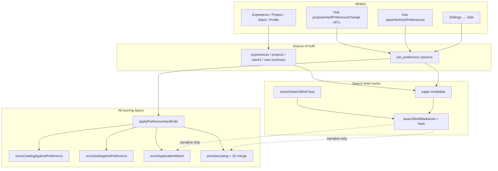
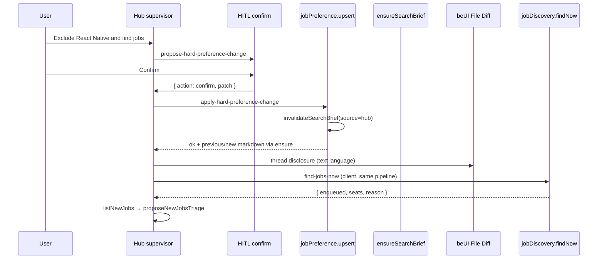
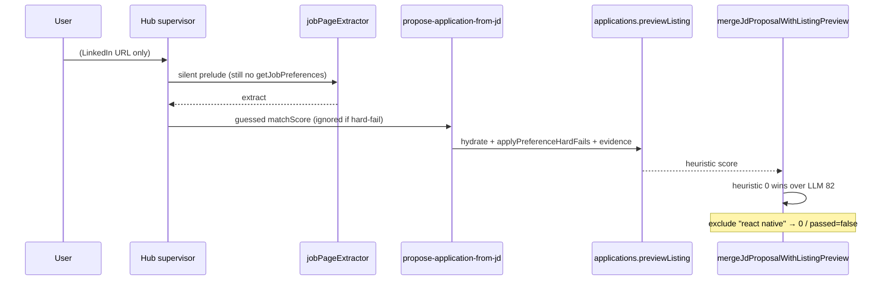

# Search brief + hub operator — design

**Date:** 2026-08-16  
**Author:** Salah  
**Status:** Accepted (grill complete; ready for implementation plan)  
**Surfaces:** Settings → Jobs, dashboard entity forms, hub chat (`/dashboard` + floater), New jobs / Find jobs now, harvest + inbox-AI + hub JD card  
**Verification skill:** [app-ai-feature-hardening](../../../.agents/skills/app-ai-feature-hardening/SKILL.md) (required after implement; living lessons in that skill’s `LESSONS.md`)  
**Glossary:** [CONTEXT.md](../../../CONTEXT.md) — Job search section is source of terms (`job preference`, `search brief`, `level floor`, `remote regions`, `hub operator`, `entity form panel`)  
**Related:**

- [Job preference two-axis matching](./2026-08-15-job-preference-two-axis-extraction-design.md) — **amended** (remote axis + `user.hasWorldwide`)
- [Job discovery adapters](./2026-08-14-job-discovery-adapters-design.md) — cheap exclude / title phrase match
- [Hub agent superpowers tools](./2026-08-13-hub-agent-superpowers-tools-design.md) — URL-import scoring; silent prelude stays
- [Hub HITL card family](./2026-08-15-hub-hitl-card-family-design.md) — confirm card for hard stops
- [Hub onboarding playbook](./2026-08-15-hub-onboarding-playbook-design.md) — **amended** (search-loop writes ≠ full prefs elicitation)
- [Career Inbox + AI platform](./2026-07-29-career-inbox-ai-platform-design.md)
- ADR [0025](../../adr/0025-entity-form-sheet.md) — entity form panel

**Does not reopen.** Grill lock from the product owner. Implementation may refine file names, not the frozen table.

---

## 1. Goal

Make **job preference** the only source of truth for what the seeker wants, expose the missing hard-stop fields (level floor, monthly salary, remote regions), and make **every** scoring path obey those columns — including hub URL-paste.

Give the hub supervisor a **search-loop operator** on the same Career OS objects (prefs, search brief, evidence forms, Find jobs now, New jobs, apply). Chat is another door, not a second product.

Give AI layers **one generated markdown artifact** — the **search brief** — so “who am I / what am I looking for?” has a single document. Paragraphs never override structured hard stops.

**Incident that forced this:** hub URL-paste scored a **Senior React Native Engineer** at **82%** despite exclude keyword `react native`. Root causes (all real in tree today):

| Fault                                                                              | Where                                                                                                                                            |
| ---------------------------------------------------------------------------------- | ------------------------------------------------------------------------------------------------------------------------------------------------ |
| Hub card prefers any LLM `matchScore > 0` over preview heuristic                   | `mergeJdProposalWithListingPreview` in `apps/web/src/features/agent-hub/lib/complete-jd-proposal.ts` (`inputScore > 0` wins)                     |
| URL-import prelude **forbids** `getJobPreferences`                                 | `HUB_JOB_URL_IMPORT_FEEDBACK` in `apps/agent/src/mastra/lib/hub-superpowers-policy.ts`                                                           |
| Agent take prompt omits exclude + evidence                                         | `prefsSummaryFromRow` in `packages/api/src/lib/application/generate-agent-take.ts`                                                               |
| AI scorer can ignore a heuristic exclude-zero                                      | `scoreApplicationMatch` in `packages/api/src/lib/application/score-application-match.ts` uses `hit.passed` without short-circuit                 |
| Exclude / role match is raw substring                                              | `includesAny` in `packages/core/src/mail/job-harvest.ts` and `packages/core/src/job-discovery/cheap-score.ts` — `react` is inside `react native` |
| Frontend title pack seeds `react`                                                  | `TITLE_PACKS.frontend` / `fullstack` in `packages/core/src/job-discovery/constants.ts`                                                           |
| Salary columns exist but are not on the Jobs form                                  | `salaryMin` / `salaryCurrency` on `job_preference`; omitted from `JobPreferenceFields` / `JobPreferenceFormState`                                |
| `hiringRegionsOverlap` treats user `worldwide` as a pass for **hybrid/onsite** too | `packages/core/src/job-discovery/hiring-region.ts` (`user.hasWorldwide return true`)                                                             |

---

## 2. Non-goals

- A second Career identity file, editable markdown source, or scoring from brief prose.
- Negotiation coach, handbooks, mock interviews, visibility modes, Jill-clone career OS.
- Target sectors, target companies, extra title lists, expected pay, fit calibration bands (deferred).
- FX conversion (currency mismatch is **not** a kill).
- Extracting `ExperienceForm` / `ProjectForm` / `StackForm` into `packages/ui`.
- Duplicating those forms as hub-only chat forms.
- Opening a side panel for the search brief (jal-co Diff Viewer is **out**).
- A second Find jobs / ingest / land pipeline.
- Inferring hard stops from spoken prose (“I’m more senior now” must not raise `levelFloor`).
- Platform-funded LLM keys. Brief prose uses tenant BYO (`scorer`), same as today’s take/score.
- Changing N range, 50-cap, 2×N, TTL, adapter set, or evaluate-then-insert (two-axis spec still owns those).
- Playbook full-form `upsert-job-preferences` elicitation as the **search-loop** write path (playbook 3b may still mount `JobPreferenceFields` for onboarding; this spec does not).

---

## 3. Frozen decisions (grill log)

| #   | Topic            | Decision                                                                                                                                                                                                                                                                                                                                                                                                                                                         |
| --- | ---------------- | ---------------------------------------------------------------------------------------------------------------------------------------------------------------------------------------------------------------------------------------------------------------------------------------------------------------------------------------------------------------------------------------------------------------------------------------------------------------- |
| 1   | Artifact         | **One artifact: Search brief.** Opening + skills paragraphs = who I am (experiences / stacks / projects / profile). Lists restate job preference. “What is my identity?” reads this brief. Paragraphs are **never** hard stops. Only Exclusions, compensation Minimum, and Level floor are law. Scorers use **structured columns**, not prose.                                                                                                                   |
| 2   | Source of truth  | **Job preference** is SoT. Settings + spoken writes. Search brief is a generated projection / cache.                                                                                                                                                                                                                                                                                                                                                             |
| 3   | v1 fields        | **Level floor** `junior \| mid \| senior \| staff`. **Monthly** salary floor + ISO currency (`salaryMin` + `salaryCurrency` already in DB — must surface). One exclude list (existing). Split location: **`locations`** = onsite/hybrid places; **`remoteRegions`** empty = worldwide remote, else only those hiring regions. **Do not** put `worldwide` on the hybrid locations list. Defer: sectors, companies, extra titles, expected pay, calibration bands. |
| 4   | Cache            | **Lazy rebuild + eager invalidate.** Store markdown + content hash next to job preference. Any successful write to prefs or evidence (Settings, hub speech, entity form) **clears cache immediately**. Next AI layer rebuilds if hash stale / missing. **Never** score against previous markdown after invalidate.                                                                                                                                               |
| 5   | Hub              | **Operator, not Jill clone.** Chat is another door to the same objects. Dashboard stays the board. v1 conversation = search loop: brief, spoken prefs, evidence forms, Find jobs now, list/triage, apply.                                                                                                                                                                                                                                                        |
| 6   | Write policy     | **Immediate:** title pack, role keywords, work modes, locations, remote regions. **Confirm card (small HITL):** salary floor, exclude keywords, level floor. **Never** infer a hard stop from prose.                                                                                                                                                                                                                                                             |
| 7   | Evidence forms   | Open the **original** `ExperienceForm` / `ProjectForm` / `StackForm` in the existing `EntityFormSheet` (ADR 0025) via a **dashboard host** on the current dashboard route (stay put). Kind registry `experience \| project \| stack` (later `application`). Do **not** extract forms to `packages/ui`. Do **not** duplicate chat forms. Close panel with existing animation on successful save; then complete the hub tool.                                      |
| 8   | Search from chat | **Find jobs now** (same ingest / land / inbox / daily cap), then `listNewJobs` / `proposeNewJobsTriage`. No second pipeline.                                                                                                                                                                                                                                                                                                                                     |
| 9   | Brief change UI  | **beUI File Diff in the hub thread only** (previous snapshot vs new markdown, `language="text"`). **No side panel.** jal-co Diff Viewer is out. Snapshot is for the thread disclosure only, not for scoring. If an entity form is open, **form host wins the panel**.                                                                                                                                                                                            |
| 10  | Remote two-axis  | `locations` gate **hybrid/onsite only**. `remoteRegions` empty → remote worldwide. `remoteRegions` set → remote must overlap those regions.                                                                                                                                                                                                                                                                                                                      |
| 11  | Phrase match     | Fix `react` matching `react native` (word/phrase boundary). Exclude remains hard fail in `scoreJobAgainstPreference` **and** cheap-score **and** inbox AI **and** hub preview/JD card. Hub JD card must **not** prefer LLM `matchScore` over exclude-zero.                                                                                                                                                                                                       |

---

## 4. Key Decisions

Implementation-facing restatement of the grill. These are the contracts PRs must implement.

1. **SoT vs cache.** Persist structured prefs on `job_preference`. Persist `searchBriefMarkdown` + `searchBriefHash` (+ previous-markdown snapshot for File Diff only) on the same row. Hash is of the **source payload** (prefs columns + evidence fingerprint + profile name/summary), not of the markdown. Invalidate = null markdown + null hash (copy outgoing markdown into `searchBriefPreviousMarkdown` first). Rebuild is lazy on the next AI consumer.

2. **Hard stops are columns.** `excludeKeywords`, `levelFloor`, `salaryMin`+`salaryCurrency`, two-axis (`workModes` + `locations` + `remoteRegions`). Brief prose and LLM judgment cannot pass a hard-fail.

3. **One hard-fail function.** `applyPreferenceHardFails` in `@tsu-stack/core` is the first stage of cheap, harvest heuristic, inbox AI, preview listing, and hub JD merge. AI `passed` is AND-ed with “no hard fail.”

4. **Phrase identity, not substring.** `matchesKeywordPhrase` tokenizes, merges a closed compound list (`react native`, `next js`, `node js`, …), then requires an exact contiguous token span. `react` does **not** match `Senior React Native Engineer`. `react native` does.

5. **Remote axis split.** `TwoAxisPrefs` gains `remoteRegions`. `hiringRegionsOverlap` must **not** treat user `worldwide` on `locations` as a hybrid/onsite pass. Worldwide remote is `remoteRegions.length === 0`.

6. **Hub is a door.** New tools wrap existing domain / existing oRPC (`jobPreference.upsert`, `jobDiscovery.findNow`, original entity forms). No parallel search, no hub-only forms.

7. **URL import stays silent; scoring moves server-side.** Keep `getJobPreferences` locked out of the extract prelude. `applications.previewListing` / `previewListingTake` / JD merge apply the unified scorer + full prefs + evidence + brief-for-narrative.

8. **BYO + tenant.** Brief generation uses `resolveRuntimeAiCredentials(userId, "scorer")`. No key → structured lists only, no invented prose. `userId` only from session / `requestContext`.

9. **Playbook vs search loop.** Onboarding playbook may still elicit the full Jobs form. The search-loop operator uses immediate soft writes + a small hard-stop confirm card — not `JobPreferenceFields` in the thread.

---

## 5. Current state (verified)

### Preference storage

`packages/db/src/schema/job-preference.schema.ts` — one row per user (`job_preference_user_id_unique_idx`). Already has `salaryMin`, `salaryCurrency`, `excludeKeywords`, `locations`, `workModes`. **No** `levelFloor`, **no** `remoteRegions`, **no** brief columns.

`packages/core/src/job-preference/types.ts` — `JobPreferenceFieldsSchema` includes salary; `UpsertJobPreferenceInputSchema` already accepts it.

`apps/web/src/features/job-preference/ui/job-preference-fields.tsx` + `lib/job-preference-form.ts` — **no salary fields**, no level, no remote regions. Locations copy still says remote uses hiring-region overlap against the **same** locations list.

### Scoring

```
cheap (catalog structured)     scoreCatalogAgainstPreference   — substring exclude
harvest heuristic              scoreJobAgainstPreference       — substring exclude; no salary/level kill; location ± includesAny
$0 two-axis                    decideTwoAxis                   — remote overlaps user.locations; user worldwide passes hybrid
inbox AI                       scoreApplicationMatch          — AI can ignore heuristic exclude
hub preview                    applications.previewListing    — heuristic without evidence
hub JD merge                   mergeJdProposalWithListingPreview — LLM score > 0 wins
agent take                     prefsSummaryFromRow            — omits exclude, evidence, brief
```

`haystackHasPhrase` already exists in `job-harvest.ts` for evidence stacks, but exclude / role keywords still use `String.includes`.

### Hub

`createHubSupervisor` has `getJobPreferences` (read) and no upsert / findNow / open-entity-form. URL paste forces extract → `propose-application-from-jd` with a model-guessed `matchScore`.

Entity forms already take `{ open, onOpenChange, initialData }` and call `onOpenChange(false)` on successful create/update. Dashboard layout (`apps/web/src/routes/(root-layout)/__protected/dashboard/route.tsx`) already hosts `HubChatProvider`, `HubApplicationsSync`, and `DetectStacksResultsHost` — the pattern for a stay-put form host.

Find jobs now is `jobDiscovery.findNow` → ingest/land queues (`packages/api/src/routers/job-discovery.router.ts` + `apps/web/src/features/job-discovery/api/find-jobs-now-job.tsx`). Daily 2×N + 50 inbox cap unchanged.

---

## 6. Proposed design

### 6.1 Architecture

```text
                    Settings Jobs form          Hub speech
                    Entity forms / profile      (soft write / hard HITL)
                              │                           │
                              ▼                           ▼
                     jobPreference.upsert          same repo upsert
                              │                           │
                              ▼                           ▼
                    invalidateSearchBrief(userId, source)
                              │
                              │  markdown=null, hash=null
                              │  previous = outgoing markdown
                              ▼
                 ┌────────────────────────────────────────┐
                 │ job_preference (SoT + brief cache)     │
                 │  structured columns                    │
                 │  searchBriefMarkdown / Hash / Previous │
                 └────────────────────────────────────────┘
                              │
          next AI consumer (lazy) if hash miss / stale
                              │
                              ▼
                 ensureSearchBrief(userId)  — BYO scorer
                    │                    │
                    │ has key            │ no key
                    ▼                    ▼
                 prose + lists        lists only (no invented paragraphs)
                              │
                              ▼
        inject structured prefs + evidence + brief(narrative)
        into: cheap / harvest / inbox AI / preview / take / hub card
```



### 6.2 Search brief markdown (v1)

Fill only what we store or can infer. **Omit** unused headings so models do not invent Target sectors / companies / Fit calibration.

```markdown
{opening paragraph — AI from evidence + title pack + profile name/summary}

## Target jobs

- Example titles: {title pack label and/or customTitle; else roleKeywords}
- Level floor: {junior|mid|senior|staff or "none"}
- Exclusions: {excludeKeywords joined, or "none"}

## Location

- Modes: {workModes or "any"}
- On-site / hybrid places: {locations or "none — onsite/hybrid will not land"}
- Remote regions: {remoteRegions or "worldwide"}

## Compensation

- Minimum monthly: {salaryMin salaryCurrency or "none"}

## Skills

{paragraph — wants to work with featured/stack names + project titles}

- Exclusions: {excludeKeywords or "none"}
```

Opening + Skills paragraphs are **who I am**. Lists **restate columns**. If BYO key is missing, emit the list sections from columns only (no opening/skills prose).

Canonical source payload for `searchBriefHash` (SHA-256 of stable JSON, keys sorted):

```ts
type SearchBriefSource = {
  prefs: {
    workModes: WorkMode[];
    locations: string[];
    remoteRegions: string[];
    roleKeywords: string[];
    excludeKeywords: string[];
    salaryMin: number | null;
    salaryCurrency: string | null;
    levelFloor: LevelFloor | null;
    titleId: JobTitleId | null;
    customTitle: string | null;
  };
  evidence: SeekerMatchEvidence;
  profile: { name: string; summary: string };
};
```

`jobsPerRun`, `minMatchScore`, `importFromEmail` are **not** in the brief source (they do not change the document).

### 6.3 Phrase matching

New helper in `packages/core` (shared by cheap + harvest + hard-fail):

```ts
/** Closed compounds merged into a single token after normalize. */
export const KEYWORD_COMPOUNDS = [
  "react native",
  "next js",
  "node js",
  "vue js",
  "nuxt js",
  "react js",
  "tailwind css"
] as const;

export function matchesKeywordPhrase(haystack: string, keyword: string): boolean;
export function findMatchingKeywords(haystack: string, keywords: readonly string[]): string[];
```

Algorithm:

1. Normalize: lowercase; map `[._/+-]` → space; collapse whitespace. Keep `#` / `+` glued (`c++`, `c#`).
2. Tokenize on spaces.
3. Merge adjacent tokens that form a `KEYWORD_COMPOUNDS` entry (longest first).
4. Keyword matches iff its token sequence appears as an **exact contiguous span**.

Locked examples:

| Haystack                     | Keyword        | Match                                                                                 |
| ---------------------------- | -------------- | ------------------------------------------------------------------------------------- |
| Senior React Native Engineer | `react native` | **yes**                                                                               |
| Senior React Native Engineer | `react`        | **no**                                                                                |
| Senior React Engineer        | `react`        | **yes**                                                                               |
| React.js Developer           | `react`        | **yes** (`react.js` → `react` + `js`; `react` is a full token, not a compound prefix) |
| PHP Engineer                 | `php`          | **yes**                                                                               |

Replace `includesAny` in exclude + role-keyword title hits. **Do not** use this for free-text location overlap (that stays `normalizeHiringRegion`).

`haystackHasPhrase` in `job-harvest.ts` is **not** sufficient (it still matches `react` inside `react native`). New helper is the exclude/role path.

### 6.4 Scoring contract

#### Hard fails (all layers)

`applyPreferenceHardFails(job, prefs) → { failed, reasons }`

| Rule           | Kill when                                                                             | Not a kill when                                                                                                                                                                                      |
| -------------- | ------------------------------------------------------------------------------------- | ---------------------------------------------------------------------------------------------------------------------------------------------------------------------------------------------------- |
| Exclude phrase | `findMatchingKeywords(title+company+location+description, excludeKeywords)` non-empty | No phrase hit                                                                                                                                                                                        |
| Level floor    | `inferTitleSeniority(title)` is known **and** `< levelFloor`                          | Floor unset; seniority unknown                                                                                                                                                                       |
| Salary floor   | Stated pay converts to monthly **same currency** and is **< salaryMin**               | Pay unknown; currency mismatch; unparsable range                                                                                                                                                     |
| Two-axis       | `decideTwoAxis` returns `drop`                                                        | Work mode unknown is still a drop **at the two-axis gate** (existing two-axis spec). Cheap/hub: if mode unknown, do **not** invent mode; cheap may still rank; land/evaluate still drop unknown mode |

`inferTitleSeniority(title)`:

| Tokens in title                 | Level            |
| ------------------------------- | ---------------- |
| intern, junior, jr, associate   | `junior`         |
| mid, mid-level, midlevel        | `mid`            |
| senior, sr                      | `senior`         |
| staff, principal, distinguished | `staff`          |
| otherwise                       | `null` (unknown) |

Order: `junior < mid < senior < staff`. Floor `senior` kills junior/mid; passes senior/staff.

Salary compare (conservative, $0):

- Prefs `salaryMin` is **monthly**.
- Prefer explicit period in `salaryRange` (`/mo`, `per month`, `/yr`, `per annum`, `k/year`).
- Structured catalog `salaryMin`: if ISO in `{USD,EUR,GBP,CAD,AUD}` and amount ≥ 15_000, treat as **annual / 12**; else if amount looks monthly, compare directly; else **unknown → not a kill**.
- Currency: uppercase ISO; compare only when equal. **No FX.** Mismatch → not a kill.

```ts
export function applyPreferenceHardFails(
  job: {
    title: string;
    companyName?: string | null;
    location?: string | null;
    description?: string | null;
    salaryRange?: string | null;
    salaryMin?: number | null;
    salaryCurrency?: string | null;
    workMode?: WorkMode | null;
    hiringRegion?: string | null;
  },
  prefs: ScoreJobPreferenceInput
): { failed: boolean; reasons: string[] };
```

Call sites **must** run this first:

| Layer             | File                                             | Today                              | After                                                                                      |
| ----------------- | ------------------------------------------------ | ---------------------------------- | ------------------------------------------------------------------------------------------ |
| Cheap             | `packages/core/src/job-discovery/cheap-score.ts` | substring exclude                  | hard-fails + phrase role keywords                                                          |
| Harvest heuristic | `scoreJobAgainstPreference`                      | substring exclude; no salary/level | hard-fails then ranking / evidence                                                         |
| Inbox AI          | `scoreApplicationMatch`                          | AI `passed` can ignore exclude     | if hard-fail → return heuristic 0, `source: "heuristic"`; never call / never trust AI pass |
| Preview           | `applications.previewListing`                    | heuristic, no evidence             | load evidence; hard-fails; persist score                                                   |
| Hub JD merge      | `complete-jd-proposal.ts`                        | LLM `> 0` wins                     | if hard-fail or heuristic 0/excluded → **0**; never keep a guessed score                   |
| Take              | `generate-agent-take.ts`                         | prefs omit exclude                 | full prefs + evidence + brief (narrative)                                                  |

`ScoreJobPreferenceInput` / `HarvestJobPreferenceSchema` / `formatJobMatchScorePrompt` gain `levelFloor` + `remoteRegions`. Prompt text: hard stops are law; brief is flavor only.

`scoreJobAgainstPreference` after hard-fails: keep role-keyword title requirement (now phrase match), evidence bonuses, `minMatchScore`. Soft work-mode/location ±15 is **ranking only** among passers; two-axis already killed mismatches.

Hub merge (replace today’s ternary):

```ts
const heuristic = previewScore; // from previewListing unified scorer
const matchScore =
  heuristic != null && heuristic === 0 ? 0 : heuristic != null ? heuristic : inputScore;
```

Do **not** prefer `inputScore > 0` when heuristic is 0.

URL-import prelude **stays** locked (`getJobPreferences` / `list*` forbidden until propose). Scoring does **not** need the model to see prefs; the server card path does.

### 6.5 Two-axis remote split

`TwoAxisPrefs`:

```ts
export type TwoAxisPrefs = {
  workModes: Array<"remote" | "hybrid" | "onsite">;
  locations: string[]; // onsite / hybrid places only
  remoteRegions: string[]; // empty = worldwide remote
};
```

`decideTwoAxis`:

```
if workMode unknown → drop          // unchanged
if modes filtered and listing.mode ∉ modes → drop

if onsite | hybrid:
  if locations empty → drop
  if !hiringRegionsOverlap(locations, region, location) → drop
  // NEVER consult remoteRegions
  // NEVER treat a worldwide token on locations as a pass
  pass

if remote:
  if remote not allowed → drop
  if remoteRegions empty → pass     // worldwide remote
  if listing region unknown (and location not a known slug) → pass as worldwide
  if !hiringRegionsOverlap(remoteRegions, region, location) → drop
  pass
```

`hiringRegionsOverlap` change:

- Add option `{ allowUserWorldwide: boolean }` **or** split helpers.
- Onsite/hybrid path calls overlap **with user-worldwide disabled**. Strip `worldwide` / `anywhere` / `global` from `locations` on write so they cannot sneak in.
- Remote path uses `remoteRegions` only. Empty `remoteRegions` short-circuits to pass (do not require a listing overlap).

Migration: if a stored `locations` token normalizes to `worldwide`, **remove it from `locations`**. Do **not** copy it onto `remoteRegions` (empty already means worldwide remote).

Update copy on Settings locations: “On-site and hybrid must match these places. Do not add Worldwide here.” New `remoteRegions` tags field: “Empty = anywhere remote. Add MENA / EU / US only to restrict.”

Update `countTwoAxisPassedUnseen`, `decideLandCandidate`, `inbox-ai` `decideTwoAxis` call sites to pass `remoteRegions`.

### 6.6 Data model

`job_preference` adds:

| Column                           | Type                          | Notes                                       |
| -------------------------------- | ----------------------------- | ------------------------------------------- |
| `level_floor`                    | `text` null                   | `junior \| mid \| senior \| staff`          |
| `remote_regions`                 | `jsonb` not null default `[]` | `string[]`, same 50×120 limits as locations |
| `search_brief_markdown`          | `text` null                   | current cache                               |
| `search_brief_hash`              | `text` null                   | sha256 hex of source payload                |
| `search_brief_previous_markdown` | `text` null                   | last markdown, File Diff only               |
| `search_brief_built_at`          | `timestamptz` null            | last successful rebuild                     |

Drizzle schema + `packages/db/src/types` regen. Repository `upsert` / `findByUserId` map the new columns. Brief columns are **not** part of `UpsertJobPreferenceInput` (writers go through invalidate / ensure helpers).

`JobPreference` / form / output schemas gain `levelFloor` + `remoteRegions`. `defaultJobPreference`: `levelFloor: null`, `remoteRegions: []`. `mergeJobPreference` merges them. `isOpenJobPreference` is closed if `levelFloor` or `remoteRegions` is set (and still if salary/exclude/etc.).

Normalize on write:

```ts
export function normalizeLocations(tokens: string[]): string[];
// drop empty; drop tokens whose hiring-region slug is worldwide
export function normalizeRemoteRegions(tokens: string[]): string[];
// map synonyms to slugs where known; keep city-like strings for overlap
```

### 6.7 Invalidate + rebuild

```ts
// packages/api — agent-safe pieces that only need db + core live next to load-job-preference
export async function invalidateSearchBrief(
  userId: string,
  source: "settings" | "hub" | "form" | "profile"
): Promise<void>;

export async function ensureSearchBrief(
  userId: string,
  llm?: RuntimeLlmConfig
): Promise<{
  markdown: string | null;
  hash: string;
  rebuilt: boolean;
  previousMarkdown: string | null;
  proseSkipped: boolean;
}>;
```

**Invalidate** (same transaction as the successful write when possible):

1. Read current markdown.
2. `searchBriefPreviousMarkdown = current markdown` (or keep previous if current already null).
3. Set `searchBriefMarkdown = null`, `searchBriefHash = null`, `searchBriefBuiltAt = null`.
4. Wide-event `search_brief_invalidated` `{ userId, source, hadMarkdown }`.

Call after:

- `jobPreference.upsert` (Settings + hub soft/hard)
- experience / project / stack **create, update, delete** (not reorder, not portfolio-include-only)
- profile **name / summary** update (opening paragraph)

**Ensure** (next AI consumer: preview, score, take, `getSearchBrief`, hub inject):

1. Load prefs + evidence + profile; compute source hash.
2. If stored markdown exists and `storedHash === sourceHash` → return it (no LLM).
3. Else rebuild:
   - Lists always from columns (deterministic renderer in core).
   - Paragraphs: one `job-agent-take`-style generate via BYO `scorer` (new thin agent `search-brief-writer` **or** a dedicated generate in `packages/api` — not a Mastra workflow). Prompt: fill opening + skills only; do not invent sectors/companies/pay; do not contradict lists.
   - No key / generate fail → persist lists-only markdown, `proseSkipped: true`.
4. Persist markdown + hash + `builtAt`. Return `previousMarkdown` for File Diff (do not use it for scoring).
5. Wide-event `search_brief_rebuilt` `{ userId, hash, source, proseSkipped }`.

Hub after a write that invalidates: if `previousMarkdown` and new markdown differ, the `getSearchBrief` / upsert tool result includes both so the toolkit can render File Diff. **Do not** open the side panel.

### 6.8 Settings → Jobs

Extend `JobPreferenceFormState` + `JobPreferenceFields`:

- **Level floor** — single select, optional (empty = no floor). Values `junior | mid | senior | staff`.
- **Minimum monthly** — number input, optional null. Existing `salaryMin`.
- **Currency** — short ISO combobox / input (`USD`, `EUR`, `GBP`, `EGP`, `SAR`, `AED`, …), existing `salaryCurrency` (trim, upper, max 8).
- **Remote regions** — `TagsField`, empty = worldwide remote.
- **Locations** — keep; rewrite description (onsite/hybrid only; no Worldwide).
- Exclude / title / modes / N / minMatch / mail toggle unchanged.

`jobPreferenceInputFromForm` sends the new fields. Upsert already merges salary; extend for level + remoteRegions.

Onboarding Jobs step uses the same `JobPreferenceFields` — it inherits the new fields (one form module).

### 6.9 Hub operator (search loop)

#### Tools (K2+ mini; register in `apps/agent/src/mastra/index.ts` + `createHubSupervisor`)

| Tool id                          | Execute                       | Completes with                                                                                                                |
| -------------------------------- | ----------------------------- | ----------------------------------------------------------------------------------------------------------------------------- |
| `get-search-brief`               | server                        | `{ markdown, hash, structured, proseSkipped }` — calls `ensureSearchBrief`. “What is my identity?” / “what am I looking for?” |
| `upsert-soft-job-preferences`    | server                        | `{ ok, preferences, brief? }` — titleId, customTitle, roleKeywords, workModes, locations, remoteRegions only                  |
| `propose-hard-preference-change` | **no execute** (HITL confirm) | `{ action: confirm \| cancel, patch }` — salaryMin, salaryCurrency, excludeKeywords, levelFloor                               |
| `apply-hard-preference-change`   | server                        | `{ ok, preferences, brief? }` — only after confirm; same repo upsert                                                          |
| `open-entity-form`               | **no execute** (client)       | `{ ok, kind, id?, saved, cancelled? }`                                                                                        |
| `find-jobs-now`                  | **no execute** (client)       | `FindJobsNowOutput` — wraps existing mutation                                                                                 |

Keep `getJobPreferences` for structured reads. Extend its output with `levelFloor` + `remoteRegions`.

**Write policy (instructions + Zod):**

- Soft tool **rejects** hard-stop keys (schema omit). If the user said “exclude React Native” / “salary at least 4k USD” / “nothing below senior”, call `propose-hard-preference-change` — do not guess the write.
- Hard HITL: `HubHitlFrame` kind `confirm` (HITL family). Body is a short summary of the proposed patch (chips), not `JobPreferenceFields`. Confirm → `apply-hard-preference-change`. Cancel → no write.
- “I’m more senior now” / “I don’t like mobile anymore” as **prose only** → ask or propose a card; **never** auto-set `levelFloor` / exclude.

`get-search-brief` after a write returns `{ previousMarkdown, markdown }` when they differ. Toolkit renders beUI **File Diff** (`npx shadcn@latest add @beui/file-diff` → `apps/web/src/shared/ui/agents/file-diff/`, same home as `agent-activity`). Props: `file="search-brief.md"`, `language="text"`, `status="complete"`, `collapseOnComplete`, `lines` from a line-diff of previous vs new. **Not** a panel. jal-co Diff Viewer stays out.

**Find jobs now:** client tool calls `startFindJobsNow` / `orpcClient.jobDiscovery.findNow` — same toast, same ingest/land/2×N/50-cap. Agent then `listNewJobs` → `proposeNewJobsTriage` (existing golden path). Reasons `title_required` / `inbox_full` / `ai_budget` / `queue_unavailable` surface as tool output; no parallel enqueue in Mastra (agent must not import `@tsu-stack/api`).

**Open entity form:**

```ts
input: { kind: "experience" | "project" | "stack"; id?: string | null }
// omit / null id = create
```

Dashboard host (layout, next to `DetectStacksResultsHost`):

```ts
type EntityFormHostRequest = {
  requestId: string;
  kind: "experience" | "project" | "stack";
  id: string | null;
};
```

Zustand/store like detect-stacks. Host remounts the **original** page form with `open` / `onOpenChange` / `initialData` (`{ id }` is enough — forms already query on edit). Stay on the current route (`openSurface` is **not** required). On save, form already closes the sheet; host `addToolOutput({ saved: true, id })`. On discard, `{ saved: false, cancelled: true }`.

**Panel mutex:** if the user is on Experiences and the page form is open, host request **wins** — close the page-local form (or refuse to double-mount two `EntityFormSheet`s). Brief never uses the panel.

Later: `kind: "application"` reuses `application-form-sheet.tsx` — not v1.

#### Supervisor instructions (search loop)

Map casual phrases:

| User says                                                     | Tool                                        |
| ------------------------------------------------------------- | ------------------------------------------- |
| who am I, my identity, career brief                           | `getSearchBrief`                            |
| looking for remote EU, add keyword X, switch to frontend pack | `upsertSoftJobPreferences`                  |
| exclude RN, salary floor, nothing below senior                | `proposeHardPreferenceChange`               |
| add a job / project / stack, edit that experience             | `openEntityForm`                            |
| find jobs, search now                                         | `findJobsNow` then list/triage              |
| paste URL / JD                                                | existing extract → propose (server rescore) |

Do **not** add negotiation / interview / handbook tools.

Activity labels (`hub-agent-activity.ts`): “Updating job preferences”, “Opening experience form”, “Finding jobs”, “Rebuilding search brief”. File Diff and HITL confirm are **choice** surfaces — not compact activity rows.

### 6.10 Sequence (spoken hard stop + Find now)



URL-paste path after this spec:



---

## 7. API / interface changes

### Core

```ts
export const LevelFloorSchema = z.enum(["junior", "mid", "senior", "staff"]);
export type LevelFloor = z.infer<typeof LevelFloorSchema>;

// JobPreferenceFieldsSchema +=
levelFloor: LevelFloorSchema.nullable(),
remoteRegions: preferenceStringList,

// UpsertJobPreferenceInputSchema += same, optional
```

New modules (suggested):

- `packages/core/src/job-preference/phrase-match.ts`
- `packages/core/src/job-preference/hard-fails.ts`
- `packages/core/src/job-preference/level.ts`
- `packages/core/src/job-preference/salary-compare.ts`
- `packages/core/src/job-preference/search-brief.ts` — deterministic list renderer + source hash (crypto-free hash input string; sha256 in api)

### oRPC

- `jobPreference.get` / `upsert` — output includes new fields; upsert invalidates brief.
- `jobPreference.getSearchBrief` (optional dedicated) **or** `get` grows `{ searchBriefMarkdown, searchBriefHash, searchBriefStale }` — prefer a **dedicated** `jobPreference.ensureBrief` used by hub `get-search-brief` so Settings GET stays cheap (no lazy LLM on page load).
- Experience / project / stack create/update/delete handlers call `invalidateSearchBrief(userId, "form")`.
- Profile update (name/summary) calls `invalidateSearchBrief(userId, "profile")`.
- `applications.previewListing` / `previewListingTake` — load evidence + `ensureSearchBrief`; take prompt includes exclude, level, salary, remoteRegions, evidence JSON, brief markdown (labeled narrative-only).

### Mastra

Register tools on `hubSupervisor`. Zod contracts in `@tsu-stack/core` (same as other hub tools). Tenant from `requestContext` only. Soft upsert uses `jobPreferenceRepository` via `createDb` / `runWithDb` (same as `get-job-preferences.tool.ts`). **Do not** import `@tsu-stack/api` into the agent bundle.

`job-preference-match` skill (`apps/agent/skills/job-preference-match/SKILL.md`): exclude / level / salary / two-axis are **hard fails**; brief is narrative; `react` ≠ `react native`.

---

## 8. Data model changes + migration

New Drizzle migration under `packages/db/migrations/`:

```sql
ALTER TABLE job_preference
  ADD COLUMN level_floor text,
  ADD COLUMN remote_regions jsonb NOT NULL DEFAULT '[]'::jsonb,
  ADD COLUMN search_brief_markdown text,
  ADD COLUMN search_brief_hash text,
  ADD COLUMN search_brief_previous_markdown text,
  ADD COLUMN search_brief_built_at timestamptz;

-- Drop worldwide tokens from onsite/hybrid locations (empty remote_regions = worldwide remote).
UPDATE job_preference
SET locations = (
  SELECT COALESCE(jsonb_agg(value), '[]'::jsonb)
  FROM jsonb_array_elements_text(locations) AS value
  WHERE lower(value) NOT IN ('worldwide', 'anywhere', 'global', 'remote worldwide')
);
```

No backfill of markdown (lazy). Follow `.agents/workflow.md` for Neon-backed generate/apply. Regen `packages/db/src/types`.

---

## 9. UI

| Surface              | Change                                                                                                                       |
| -------------------- | ---------------------------------------------------------------------------------------------------------------------------- |
| Settings → Jobs      | Level, monthly salary + currency, remote regions; locations copy                                                             |
| Onboarding Jobs step | Same fields module                                                                                                           |
| Hub thread           | Soft write = activity row + optional File Diff; hard stop = `HubHitlFrame` confirm; brief change = beUI File Diff disclosure |
| Hub entity edit      | Original form in existing panel; stay on route                                                                               |
| New jobs / Find now  | Unchanged chrome; chat uses the same button pipeline                                                                         |
| JD card              | Score from unified heuristic; 0% + exclude reason when hard-fail                                                             |

File Diff install: `@beui/file-diff` into `apps/web/src/shared/ui/agents/` (agent-activity already lives there). `language="text"`. Do not install jal-co.

---

## 10. Alternatives considered

| Alternative                                               | Why not                                                                                                                                              |
| --------------------------------------------------------- | ---------------------------------------------------------------------------------------------------------------------------------------------------- |
| **A. Second identity markdown file** (user-edited)        | Grill #1. Would drift from Settings and become a second SoT. Brief is a projection.                                                                  |
| **B. Score from brief prose** (LLM reads markdown only)   | Failed the RN incident. Prose is not law; columns are.                                                                                               |
| **C. Word-boundary regex only** (`\breact\b`)             | Still matches `react` inside `react native`. Need compound-token merge.                                                                              |
| **D. Keep `worldwide` on locations; special-case hybrid** | Grill #3/#10. Split columns so Settings cannot express the bug.                                                                                      |
| **E. Extract forms to `packages/ui` / chat-native forms** | Grill #7 + ADR 0025. Dual forms diverge (onboarding lesson). Host remounts originals.                                                                |
| **F. Jal-co Diff Viewer / side panel for brief**          | Grill #9. Wrong primitive; panel is reserved for entity forms.                                                                                       |
| **G. Hub findNow reimplements ingest/land in Mastra**     | Grill #8 + agent cannot import `@tsu-stack/api`. Client tool hits existing RPC.                                                                      |
| **H. Unlock `getJobPreferences` during URL extract**      | Prelude must stay silent/fast. Server preview already can score; unlocking would add steps and still lose to LLM `matchScore > 0` without merge fix. |

---

## 11. Security & privacy

- `userId` from session / `requestContext` only. Tool inputs never accept `userId`.
- Brief generate and scorers use **that tenant’s** BYO key (`resolveRuntimeAiCredentials(userId, "scorer")`). Never another tenant’s key or a platform key.
- Source payload and markdown are per-row; `ensureSearchBrief` loads only that `userId`.
- File Diff shows **this user’s** previous vs new brief in **their** thread (`dashboard-home:{userId}`). Snapshot is not a scoring input and is not shared.
- Soft upsert schema-excludes hard stops so a prompt-injected tool call cannot silently raise salary/exclude/level.
- `open-entity-form` only opens kinds in the registry; ids loaded with `findByIdForUser`.
- `find-jobs-now` is the existing protected RPC (same auth, same caps).

---

## 12. Observability

`@tsu-stack/logger` wide events. One `emit()` per operation. No `evlog` import from apps.

| Operation                  | Event                                                         | Fields                                                                         |
| -------------------------- | ------------------------------------------------------------- | ------------------------------------------------------------------------------ |
| `api__search_brief`        | `search_brief_invalidated`                                    | `userId`, `source` (`settings` \| `hub` \| `form` \| `profile`), `hadMarkdown` |
| `api__search_brief`        | `search_brief_rebuilt`                                        | `userId`, `hash`, `source`, `proseSkipped`                                     |
| `api__search_brief`        | `search_brief_inject`                                         | `userId`, `hash`, `consumer` (`scorer` \| `take` \| `hub` \| `preview`)        |
| `api__application_match`   | existing score events + `hard_fail` reason when short-circuit | `userId`, `reasons`                                                            |
| `api__generate_agent_take` | include `hasExclude`, `hasBrief` booleans (not the markdown)  |                                                                                |

Do not log full JD, API keys, or brief markdown bodies.

---

## 13. Rollout

1. Ship core/DB phrase match + two-axis split + hard-fails **before** trusting inbox quality. Existing inbox rows are **not** retro-scored (same stance as two-axis reset): after land-path changes, wipe **this tenant’s** discovery applications + AI budget, then Find now (two-axis spec reset).
2. Settings fields can ship as soon as schemas exist (no flag). Empty `levelFloor` / `salaryMin` / `remoteRegions` preserve today’s behavior except: (a) phrase match, (b) worldwide stripped from locations, (c) remote empty = worldwide.
3. Hub tools behind no flag once Settings works — operator is the same objects.
4. Brief cache starts empty; first AI call rebuilds.
5. **Rollback:** revert migration (drop new columns) or leave columns unused. Phrase-match revert is a core revert. Do not keep LLM-wins merge if rolling back the JD fix independently.

No feature flag required; behavior is strictly tighter filters.

---

## 14. Risks

| Risk                                                 | Sev      | Mitigation                                                                                        |
| ---------------------------------------------------- | -------- | ------------------------------------------------------------------------------------------------- |
| Any path still prefers LLM score over exclude-zero   | **High** | Single merge helper + tests; `scoreApplicationMatch` short-circuit; hardening case = RN URL paste |
| Phrase match too strict (`react.js`, `React-Native`) | **Med**  | Normalize punctuation; compounds list; tests for `.js` / hyphen / space                           |
| Annual vs monthly mis-detect kills a good role       | **Med**  | Conservative: unknown / mismatch ≠ kill; only kill when period+currency are clear                 |
| Double `EntityFormSheet` on Experiences page         | **Med**  | Host mutex; page form yields                                                                      |
| Invalidate storms (bulk organize stacks)             | **Low**  | Invalidate is a null write; rebuild is lazy once                                                  |
| No BYO key → identity answer is lists-only           | **Low**  | Documented; same as land-without-take                                                             |
| Playbook vs search-loop upsert confusion             | **Low**  | Separate tools; supervisor map; playbook still owns full form                                     |

---

## 15. PR Plan

Ordered. Each PR is independently reviewable. Later PRs depend on earlier schemas.

### PR 1 — Core/DB: fields, phrase match, two-axis remoteRegions, hard-fails

**Depends on:** nothing  
**Title:** `fix(job-preference): phrase match, level floor, remote regions, hard-fail contract`

**Files:**

- `packages/db/src/schema/job-preference.schema.ts`
- `packages/db/src/repositories/job-preference.repository.ts`
- `packages/db/src/types/job-preference.schema.ts` (regen)
- `packages/db/migrations/<new>/`
- `packages/core/src/job-preference/types.ts`, `utils.ts`, `constants.ts`, `index.ts`
- `packages/core/src/job-preference/phrase-match.ts` + tests
- `packages/core/src/job-preference/hard-fails.ts` + tests
- `packages/core/src/job-preference/level.ts` + tests
- `packages/core/src/job-preference/salary-compare.ts` + tests
- `packages/core/src/job-discovery/two-axis.ts`, `hiring-region.ts`, `cheap-score.ts`, `shelf.ts`
- `packages/core/src/mail/job-harvest.ts` (`scoreJobAgainstPreference`, drop exclude `includesAny`)
- Tests: `cheap-score`, `two-axis`, `hiring-region`, `job-harvest` score, new phrase/hard-fail suites

**Description:** Add columns + Zod. Implement `matchesKeywordPhrase` (RN fixture). `applyPreferenceHardFails`. Split `remoteRegions`. Stop `user.hasWorldwide` from passing hybrid. Cheap + harvest use hard-fails + phrase role keywords. Data migrate worldwide tokens off `locations`.

**Tests (must include):**

- exclude `react native` kills “Senior React Native Engineer”
- exclude `react` does **not** kill that title
- role keyword `react` does **not** title-hit RN; does hit “Senior React Engineer”
- `remoteRegions: []` keeps `remote+latam`; `remoteRegions: ["mena"]` drops it
- hybrid + `locations: ["worldwide"]` (if it slipped in) does **not** pass; write-normalize strips it
- salary unknown ≠ kill; same-currency monthly below floor = kill
- unknown seniority ≠ kill; junior title vs senior floor = kill

### PR 2 — Settings Jobs form: salary, level, remote regions

**Depends on:** PR 1  
**Title:** `feat(settings): surface salary floor, level floor, remote regions`

**Files:**

- `apps/web/src/features/job-preference/lib/job-preference-form.ts`
- `apps/web/src/features/job-preference/ui/job-preference-fields.tsx`
- `packages/api/src/routers/job-preference.router.ts` + `load-job-preference.ts`
- `apps/agent/src/mastra/tools/get-job-preferences.tool.ts` (output shape)
- Onboarding Jobs step inherits fields (no fork)

**Description:** Form state + fields + upsert mapping. Locations copy. Empty remote = worldwide. Do not put Worldwide on locations.

### PR 3 — Search brief persist / invalidate / generate

**Depends on:** PR 1  
**Title:** `feat(job-preference): lazy search brief cache`

**Files:**

- `packages/core/src/job-preference/search-brief.ts` (list renderer + source payload)
- `packages/api/src/lib/application/search-brief.ts` (`invalidateSearchBrief`, `ensureSearchBrief`)
- `packages/api/src/routers/job-preference.router.ts` (`ensureBrief`)
- `packages/api/src/routers/experiences.router.ts`, `projects`, `stacks`, `profile.router.ts` (invalidate)
- `apps/agent` thin writer agent **or** api-side generate (register if agent)
- Logger events

**Description:** Eager invalidate on prefs/evidence/profile writes. Lazy rebuild with BYO. No key → lists only. Previous markdown retained for File Diff only.

### PR 4 — Inject brief + prefs + evidence; fix hub JD score

**Depends on:** PR 1, PR 3  
**Title:** `fix(match): hard-fail short-circuit + hub card must not prefer LLM score`

**Files:**

- `packages/api/src/lib/application/score-application-match.ts`
- `packages/api/src/lib/application/generate-agent-take.ts`
- `packages/api/src/lib/job-discovery/inbox-ai.ts`, `land.ts`
- `packages/api/src/routers/applications.router.ts` (`previewListing`, `previewListingTake`)
- `apps/web/src/features/agent-hub/lib/complete-jd-proposal.ts` + tests
- `apps/agent/skills/job-preference-match/SKILL.md`
- `apps/agent/src/mastra/agents/job-preference-match-scorer-agent.ts`
- Keep URL-import `getJobPreferences` lockout

**Description:** Every consumer loads full prefs + evidence; brief narrative-only. AI cannot pass a hard-fail. JD merge uses heuristic 0. Preview loads evidence. Take summary includes exclude/level/salary/remoteRegions/evidence/brief.

**Hardening seed:** paste the RN listing URL with exclude `react native` → card shows 0% / excluded, not 82%.

### PR 5 — Hub tools: soft upsert, hard-stop HITL, findNow

**Depends on:** PR 2, PR 3  
**Title:** `feat(hub): search-loop preference writes + Find jobs now`

**Files:**

- `apps/agent/src/mastra/tools/upsert-soft-job-preferences.tool.ts`
- `apps/agent/src/mastra/tools/propose-hard-preference-change.tool.ts` (no execute)
- `apps/agent/src/mastra/tools/apply-hard-preference-change.tool.ts`
- `apps/agent/src/mastra/tools/find-jobs-now.tool.ts` (no execute)
- `apps/agent/src/mastra/tools/get-search-brief.tool.ts`
- `apps/agent/src/mastra/agents/hub-supervisor.ts` + policy tests
- `apps/agent/src/mastra/index.ts` (if registration is more than supervisor tools)
- `apps/web` toolkit: confirm card (`HubHitlFrame` confirm), findNow client complete (`startFindJobsNow`)
- `apps/web/src/features/agent-hub/lib/hub-tool-names.ts`, `hub-agent-activity.ts`

**Description:** Immediate soft writes. Confirm card for salary/exclude/level. Never infer hard stops. `find-jobs-now` = existing pipeline then list/triage.

### PR 6 — Dashboard entity form host + `open-entity-form`

**Depends on:** PR 3 (invalidate already on form routers)  
**Title:** `feat(hub): open original evidence forms from chat`

**Files:**

- `apps/web/src/pages/dashboard/_lib/entity-form-host.tsx` + store
- `apps/web/src/routes/(root-layout)/__protected/dashboard/route.tsx`
- `apps/agent/src/mastra/tools/open-entity-form.tool.ts`
- Toolkit UI (client complete, like `open-surface-tool-ui.tsx`)
- Page forms: yield if host owns the same kind

**Description:** Kind registry. Stay on route. Original forms. Close on save then complete tool. Mutex vs page-local sheet.

### PR 7 — beUI File Diff for brief change in thread

**Depends on:** PR 3, PR 5  
**Title:** `feat(hub): search brief File Diff disclosure`

**Files:**

- `apps/web/src/shared/ui/agents/file-diff/` (shadcn `@beui/file-diff`)
- Toolkit render on `get-search-brief` / upsert results when `previousMarkdown` ≠ `markdown`
- Line-diff helper (pure, core or feature lib)

**Description:** Thread-only, `language="text"`, collapse on complete. No panel. Form host still wins the panel.

### After PRs 4–7

Run [app-ai-feature-hardening](../../../.agents/skills/app-ai-feature-hardening/SKILL.md). Fresh report + append `LESSONS.md`.

**Entry paths that share state:** Settings save, hub soft write, hub hard confirm, entity form save, profile save, Find now (button + chat), URL paste JD card, harvest/inbox-AI, cheap land.

**User-visible success:** exclude `react native` → RN title is 0 everywhere; `react` exclude does not kill RN; “who am I?” reads the brief; spoken “remote EU” writes `remoteRegions` immediately; spoken “exclude RN” waits for confirm; Find now from chat fills the same inbox; adding an experience opens the real form and invalidates the brief (File Diff on next rebuild).

---

## 16. Open Questions

None. Grill is locked. Implementation may choose:

- Search-brief writer as a tiny Mastra agent vs `packages/api` `agentFetch` (same pattern as `generateAgentTake`) — pick whichever avoids a new workflow.
- Currency picker: closed common-ISO list + free text vs combobox only — both persist `salaryCurrency` max 8.

Those are not product forks.

---

## 17. Test / hardening contract

Core unit (PR 1):

- Phrase table in §6.3
- Two-axis: hybrid+Egypt drops `remote+latam` when `remoteRegions: ["egypt"]`; empty `remoteRegions` keeps it; hybrid is **not** passed by leftover `worldwide` location
- Level / salary tables in §6.4
- `mergeJdProposalWithListingPreview`: LLM 82 + heuristic 0 → **0**

Live (hardening skill, this tenant):

1. Settings: exclude `react native`, level `senior`, salary monthly set, `remoteRegions` MENA, locations Cairo (no Worldwide).
2. Paste Senior React Native Engineer URL → card **0% / excluded**, take mentions exclude.
3. Same listing with exclude `react` only → **not** exclude-killed (may still fail level/other).
4. “Who am I?” → brief lists match Settings; paragraphs do not invent sectors.
5. Chat: “remote EU only” → `remoteRegions` updates without a confirm card; File Diff appears after rebuild.
6. Chat: “exclude PHP” → confirm card → write → invalidate.
7. Chat: “add an experience” → original form on current route → save closes panel → brief invalidate.
8. Chat: “find jobs now” → same toast/caps as the header button; triage card if inbox non-empty.
9. Missing BYO: brief lists-only; Find now still enqueues (existing no-key land).

Wipe discovery rows for this tenant before claiming land-path correctness (two-axis spec reset still applies).

---

## 18. References

- [CONTEXT.md](../../../CONTEXT.md) — Job search glossary
- [app-ai-feature-hardening](../../../.agents/skills/app-ai-feature-hardening/SKILL.md)
- [Two-axis matching](./2026-08-15-job-preference-two-axis-extraction-design.md)
- [Discovery adapters](./2026-08-14-job-discovery-adapters-design.md)
- [Hub superpowers](./2026-08-13-hub-agent-superpowers-tools-design.md)
- [HITL card family](./2026-08-15-hub-hitl-card-family-design.md)
- [Hub playbook](./2026-08-15-hub-onboarding-playbook-design.md)
- ADR 0025 entity form sheet
- beUI File Diff: https://beui.dev/components/agents/file-diff (`@beui/file-diff`)
- Existing seams: `scoreJobAgainstPreference`, `scoreCatalogAgainstPreference`, `decideTwoAxis`, `hiringRegionsOverlap`, `scoreApplicationMatch`, `generateAgentTake`, `mergeJdProposalWithListingPreview`, `jobDiscovery.findNow`, `EntityFormSheet`, `createHubSupervisor`
